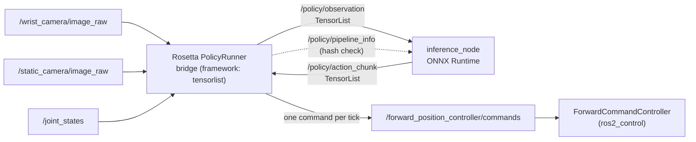
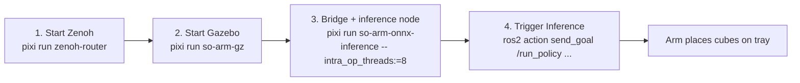

# Run the Pre-trained Policy with ONNX Runtime

This guide runs the same pre-trained ACT checkpoint as [Try a Pre-trained Policy](pretrained-demo.md), but through the new **Policy I/O** inference path instead of LeRobot's PyTorch runtime. The checkpoint is exported once to an ONNX model plus a `policy_signature.yaml`, and a generic C++ node runs it with ONNX Runtime.

> [!NOTE]
> This is **phase 1** of the [Policy I/O and inference design](../design/policy-io-and-inference.md). Phases 2–5 (action executor, C++ pre-processing, data pipeline, acceleration) are upcoming; see [§11 of the design](../design/policy-io-and-inference.md#11-migration-plan).

## What changed compared to the pre-trained demo

In [the pre-trained demo](pretrained-demo.md), Rosetta's `PolicyRunner` samples the robot topics, runs the LeRobot policy in Python, and publishes joint commands. Here Rosetta still samples the topics and still publishes the commands, but it runs as a **bridge** (`framework: tensorlist`). It publishes each sampled frame as a `pai_tensor_msgs/TensorList` on `/policy/observation`. The `inference_node` (package `pai_policy_inference`) runs the ONNX model on the newest observation and publishes a 100-step action chunk on `/policy/action_chunk`. The bridge follows that chunk and publishes one command per tick. Normalisation and the checkpoint's degree units are baked into the ONNX graph, so joint states and actions on the wire are in SI units (radians). On start-up the bridge publishes a `PipelineInfo` message with the hash of its observation pipeline. The inference node compares it with the hash in the model's signature and refuses to run on a mismatch.



## Prerequisites

Follow the main [README](../../README.md) to set up the workspace, including `pixi run install-deps` (the exporter needs PyTorch and LeRobot) and `pixi run build`. The inference node itself only needs ONNX Runtime, which the Pixi environment provides. It runs on the **CPU**: the ONNX Runtime build in the Pixi environment (1.31.0) has no CUDA provider.

> [!IMPORTANT]
> This project uses `rmw_zenoh` as the ROS 2 middleware. The Zenoh router must be
> running before launching any demo. Start it in a dedicated terminal and leave it
> running for the duration of your session:
>
> ```bash
> pixi run zenoh-router
> ```
>
> See [Running the Robot](../running-the-robot.md) for details.

---

## Export the Checkpoint

Export the Hub checkpoint into `models/act_so101/` (the `models/` directory is git-ignored):

```bash
pixi run pai_export_act \
    --pretrained francocipollone/rospai_act_sim_arm101_place_cubes_on_tray \
    --contract pai_data_collection/config/rosetta/so_arm101_policy_io.yaml \
    --robot so_arm101 \
    --legacy-units deg \
    --dataset francocipollone/rospai_sim_arm101_place_cubes_on_tray \
    --check-frames 8 \
    --out models/act_so101
```

The exporter traces the policy together with its normalisation, then runs the ONNX model and the LeRobot policy on the same frames and compares the results. It writes the model only if they agree:

```
max abs error: 1.788e-06 rad (atol 0.001)
pipeline hash: sha256:a41ccabc9378816b4cf6030c3009505f2cbfa43bad7c33a43b70a2d3ba13e4dd
wrote models/act_so101
```

The output directory holds `model.onnx` (138 MB) and `policy_signature.yaml`. The signature lists the input and output tensors, the execution settings (`horizon: 100`, `execute_steps: 30`, `strategy: blend`, `max_staleness_s: 0.2`) and the `pipeline_hash` of the contract used for the export.

| Flag                 | Why                                                                                                                                                                                                          |
| -------------------- | ------------------------------------------------------------------------------------------------------------------------------------------------------------------------------------------------------------ |
| `--legacy-units deg` | The checkpoint was trained on a dataset recorded in **degrees** (the SO-ARM101 contract's `rad2deg`). The exporter bakes `rad → deg` on the state input and `deg → rad` on the action output into the graph. |
| `--dataset`          | LeRobot dataset (Hub repo id or local root) that the equivalence frames are taken from. Without it, the exporter uses random frames.                                                                         |
| `--check-frames`     | Number of frames compared between ONNX Runtime and LeRobot (default `8`). `0` is refused unless you also pass `--unsafe-skip-check`.                                                                         |

`--contract` must be the **SI** contract (`so_arm101_policy_io.yaml`) that the bridge runs with, since its hash is written into the signature. Run `pixi run pai_export_act --help` for the remaining flags (`--execute-steps`, `--strategy`, `--max-staleness-s`, `--atol`, `--rtol`).

## Run in Gazebo



### Step 1 — Start Gazebo Simulation

In a second terminal:

```bash
pixi run so-arm-gz
```

Wait until the robot has settled and the three cubes are on the table.

### Step 2 — Launch the Bridge and the Inference Node

In a third terminal:

```bash
pixi run so-arm-onnx-inference -- intra_op_threads:=8
```

This runs `policy_io_inference.launch.py` with `use_sim_time:=true` and the model in `models/act_so101`. Arguments after `--` go to the launch file. `intra_op_threads:=8` limits ONNX Runtime to 8 threads so that Gazebo keeps enough CPU on the same machine (see [What to Expect](#what-to-expect)). Pick a value that leaves a few cores free for Gazebo on your machine. To use another model directory, pass it before the `--`: `pixi run so-arm-onnx-inference /path/to/model_dir -- intra_op_threads:=8`.

> [!WARNING]
> Without `intra_op_threads`, the launch file keeps ONNX Runtime's default of `0`, which uses every core. In our measurements that starved Gazebo down to about 0.12× real time.

The launch file starts Rosetta's `policy_runner_node` with [`policy_runner_tensorlist.yaml`](../../pai_data_collection/config/rosetta/policy_runner_tensorlist.yaml) and the [SI contract](../../pai_data_collection/config/rosetta/so_arm101_policy_io.yaml), and it starts `inference_node`. It also accepts `provider`, `contract_path`, `enforce_pipeline_hash` and `pipeline_info_timeout_s`; run `ros2 launch pai_bringup policy_io_inference.launch.py --show-args` to list them.

The inference node is ready when it logs:

```
[inference_node]: model models/act_so101: horizon=100 action_dim=6 hash OK
```

### Step 3 — Trigger Inference

In a fourth terminal:

```bash
pixi run ros2 action send_goal /run_policy \
    rosetta_interfaces/action/RunPolicy "{prompt: 'place cubes on tray'}" --feedback
```

The feedback reports `published_actions`, which keeps increasing while the bridge publishes commands. Inference runs until the goal is cancelled. `Ctrl+C` on the `send_goal` command cancels it: the client prints `Canceling goal...` and the policy runner logs `Finished (cancelled)`. You can also cancel all goals from another terminal:

```bash
pixi run ros2 service call /run_policy/_action/cancel_goal action_msgs/srv/CancelGoal "{}"
```

If the `send_goal` client is killed in any other way (for example by `timeout`), the goal keeps running on the server until it is cancelled. To run again, reset the cubes as described in [the pre-trained demo](pretrained-demo.md#reset-the-cubes-and-run-again).

### What to Expect

Measured on an Intel Core Ultra 9 275HX (24 threads) on the CPU provider, with Gazebo running headless on the same machine. All rates are wall-clock rates from `ros2 topic hz`, sampled one after the other during the run. Gazebo was running slower than real time, so the real-time factor (RTF) is listed too; at RTF 0.74, 36.6 Hz wall clock is the nominal 50 Hz in sim time.

| Configuration                                           | RTF  | `/joint_states` | `/policy/observation` | `/policy/action_chunk` | `/forward_position_controller/commands` | Result                                                                                                                                                 |
| ------------------------------------------------------- | ---- | --------------- | --------------------- | ---------------------- | --------------------------------------- | ------------------------------------------------------------------------------------------------------------------------------------------------------ |
| `-- intra_op_threads:=8`                                | 0.74 | 36.6 Hz         | 31.9 Hz               | 8.4 Hz                 | 37.4 Hz                                 | All three cubes on the tray about 34 s (sim time) after the goal                                                                                       |
| No `intra_op_threads` (ONNX Runtime default, all cores) | 0.12 | 6.9 Hz          | 24.6 Hz               | 7.5 Hz                 | 8.8 Hz                                  | Red and green cubes on the tray and blue in the gripper 36 s (sim time) after the goal, when our 90 s wall-clock time limit for the test ended the run |

One inference takes about 120 ms on this CPU (minimum interval between chunks 0.114 s with 8 threads). Each chunk holds 100 steps (2 s at 50 Hz), so the bridge never ran out of commands: the goal feedback's `queue_depth` stayed between 88 and 100 during the run. The inference node skips observations that arrive while it is busy and always runs on the newest one.

With the default `intra_op_threads: 0`, ONNX Runtime used every core: the node ran at about 2150 % CPU and Gazebo slowed to about 0.12× real time. With `intra_op_threads:=8` the node used about 780–820 % CPU. Gazebo ran at 0.74× real time in the measured run and at 0.58× in a later check, which got the same 8.3 Hz chunk rate.

---

## Inference Node Parameters

| Parameter                 | Default                 | Description                                                                                                                 |
| ------------------------- | ----------------------- | --------------------------------------------------------------------------------------------------------------------------- |
| `model_dir`               | (required)              | Directory with `model.onnx` and `policy_signature.yaml`                                                                     |
| `backend`                 | `onnxruntime`           | Inference backend. Only `onnxruntime` is supported in phase 1                                                               |
| `provider`                | `cpu`                   | ONNX Runtime execution provider: `cpu` or `cuda`. The node exits if the provider is not available in the ONNX Runtime build |
| `intra_op_threads`        | `0`                     | ONNX Runtime intra-op threads; `0` uses the ONNX Runtime default (all cores)                                                |
| `observation_topic`       | `/policy/observation`   | `TensorList` observations                                                                                                   |
| `action_chunk_topic`      | `/policy/action_chunk`  | `TensorList` action chunks                                                                                                  |
| `pipeline_info_topic`     | `/policy/pipeline_info` | `PipelineInfo` from the robot side (transient local)                                                                        |
| `enforce_pipeline_hash`   | `true`                  | Exit when the robot's pipeline hash differs from the model's. With `false` the node logs an `ERROR` and continues           |
| `pipeline_info_timeout_s` | `10.0`                  | How long to wait for `PipelineInfo` at start-up before exiting                                                              |

## Troubleshooting

**`pipeline hash mismatch`.** The contract the bridge runs with differs from the contract the model was exported with. Any change to it counts, even a QoS depth. For example, changing the `/joint_states` QoS `depth: 50` to `51` in a copy of the contract and passing it with `contract_path:=` makes the node exit:

```
[inference_node]: pipeline hash mismatch: model sha256:a41ccabc9378816b4cf6030c3009505f2cbfa43bad7c33a43b70a2d3ba13e4dd, pipeline sha256:8da3f9a5a81fa7db942dbb520d4e7901f49d967eea08bd92947a1a02978836c5
[ERROR] [inference_node-2]: process has died [pid ..., exit code 1, ...]
```

Re-export the model with the contract you deploy with. Only to debug, `enforce_pipeline_hash:=false` keeps the node running and logs the mismatch as an error instead:

```
[ERROR] [inference_node]: pipeline hash mismatch: model sha256:a41ccabc..., pipeline sha256:8da3f9a5... (enforcement disabled, continuing)
```

**`no PipelineInfo received on /policy/pipeline_info within 10 s`.** The bridge did not publish its `PipelineInfo` in time. Check that the Zenoh router is running and that the policy runner was started with `framework: tensorlist` (the `policy_runner_tensorlist.yaml` params file). Raise the timeout if the bridge starts slowly: `pixi run so-arm-onnx-inference -- pipeline_info_timeout_s:=30`.

**`execution provider 'cuda' is not available in this ONNX Runtime build`.** The ONNX Runtime library in the Pixi environment is CPU-only. Use `provider:=cpu`.

**`export refused: ... beyond atol ...`.** The exporter's equivalence check failed, and it exits with code 2 without writing a model. Check that `--legacy-units` matches the units the checkpoint was trained in (`deg` for the pre-trained checkpoint) and that `--dataset` is the dataset the checkpoint was trained on.
