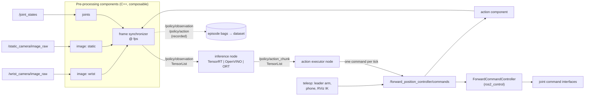

# Design: Policy I/O Convention and Inference Architecture

| | |
| --- | --- |
| **Status** | Draft, for review |
| **Scope** | How observations and actions are defined, recorded, trained on, and served for learned policies in this repository |
| **Supersedes** | The Rosetta-based runtime path (`policy_runner_node` + LeRobot policy server) once fully migrated |
| **Background** | [`docs/research/policy-execution-and-buffer-backends.md`](../research/policy-execution-and-buffer-backends.md), [`docs/research/rosetta-inference-options.md`](../research/rosetta-inference-options.md) |

## 1. Summary

This document defines one **Policy I/O Convention**: what a policy observes, what it emits, in which units, on which clock, and under which names. It also defines the architecture that implements that convention.

The central rule:

> **The convention is defined once, and exactly the same convention — implemented by exactly the same code — is used when recording data, when building training datasets, and when running inference.** Any difference between what a policy saw in training and what it sees at deployment is a bug, and the system is designed to make such differences impossible or detected, never silent.

The architecture follows the "tensor-list in, tensor-list out" pattern:

- **pre-processing components** in the ROS 2 graph turn sensor topics into a stamped `TensorList` of observations at a fixed rate;
- a **generic inference node** maps observation tensors to an action-chunk tensor and knows nothing about robots;
- an **action executor node** turns action chunks into one command per control tick and enforces safety. It publishes on the **same command topic teleoperation uses**, so recorded actions and executed actions travel the same path.

The dataset used for training **is a recording of the same observation topic** the inference node consumes. Each model carries a **policy signature** and a **pipeline hash**, and deployment refuses to start when they do not match the running pipeline.

## 2. Motivation

The current deployment path is: Rosetta `policy_runner_node` → `LeRobotPolicyRunner` → LeRobot policy server subprocess over gRPC → `forward_position_controller`.

| Problem | Consequence |
| --- | --- |
| The robot ↔ policy translation runs inside one Python node, configured by its own YAML language | Intermediate steps cannot be inspected, recorded or debugged with standard ROS tools |
| Python and a gRPC hop sit in the control path | Control-rate commands are exposed to interpreter and IPC jitter |
| Inference is tied to LeRobot's runtime | The inference engine cannot be swapped; NVIDIA, Intel and generic backends cannot share one deployment |
| Action-chunk handling lives in LeRobot's Python client | Latency compensation, blending and stall behaviour are tied to one framework's runtime and run in Python at control rate |
| Train/serve parity holds only while every component is Rosetta | Any alternative engine or C++ path must re-implement the translation and can silently diverge |

## 3. Goals and non-goals

**Goals**

| ID | Goal |
| --- | --- |
| G1 | **Parity.** A single convention, and a single implementation of every transform, shared by recording, dataset building and inference |
| G2 | **Composition.** Every processing step is a node with typed topics, observable with standard ROS tools |
| G3 | **Swappable inference.** The inference node's only interface is `TensorList` in, `TensorList` out |
| G4 | **Vendor-neutral.** ONNX models with TensorRT, OpenVINO and ONNX Runtime backends behind the same node interface |
| G5 | **No Python at control rate.** Inference rate is decoupled from control rate through action chunks |
| G6 | **Safety close to the hardware.** Limits, non-finite guards and stall behaviour are enforced in the last stage before the controller, with `ros2_control` joint limits as a backstop |
| G7 | **Training framework at the edges.** LeRobot (or any framework) only reads datasets and exports models |
| G8 | **Zero-copy ready.** Tensors travel as `rosidl::Buffer`-backed messages so accelerator backends can be enabled later without interface changes |

**Non-goals (for this design)**

- High-rate RL control policies evaluated *inside* a controller (hundreds of Hz, tiny networks). That is a separate component; see [§12](#12-alternatives-considered).
- Replacing LeRobot as the training framework. It stays; it is simply confined to the edges.
- GPU pre-processing and accelerator buffer backends in the first iteration. The interfaces allow them; enabling them is a later phase.

## 4. Architecture overview



**Modes.** During **recording**, a teleoperation source publishes commands and the inference node and action executor are not running. During **inference**, the action executor publishes commands and no teleoperation source is running. In both modes the commands travel on the same topic to the same controller, and the action component taps that topic. The synchronizer always emits `/policy/observation`, and emits `/policy/action` for recording.

The same pre-processing components run in two hosts:

- **Live:** composable nodes in a component container, as shown above.
- **Offline replay:** a deterministic replay host that loads the same component libraries and feeds recorded raw messages in timestamp order ([§8.3](#83-deterministic-replay)).

## 5. The Policy I/O Convention

This section is normative. Recording, dataset conversion, training export and inference **must** all implement it through the shared components; none may re-implement any part of it.

### 5.1 The parity rule

For the same raw sensor input, the observation tensors produced during recording and during inference must be:

- **bit-identical** for images and integer tensors;
- **identical** (same code path, same dtype) for floating-point tensors.

For the same action tensor, the command reaching the hardware must be identical whether that action came from a teleoperator during recording or from a policy during inference.

The convention is enforced in four ways:

1. **Shared implementation.** Every transform exists once, as a component library ([§6](#6-pre-processing-components)).
2. **Recorded model inputs.** The training dataset is a recording of `/policy/observation` itself ([§8.1](#81-recording)), so training data is by construction what the inference node sees.
3. **Provenance check.** The pipeline hash ([§5.8](#58-pipeline-hash-and-provenance)) travels with datasets and models, and a mismatch is a startup error.
4. **Shared action path.** Teleoperation and the action executor publish to the same command topic, in the same convention, executed by the same controller ([§4](#4-architecture-overview), [§9](#9-action-execution)). The recorded action is read from that topic, so it is exactly what the controller received.

### 5.2 Names

Tensors are identified by **name**, never by position. Names are dotted keys:

| Name | Meaning |
| --- | --- |
| `observation.images.<camera>` | One camera image, e.g. `observation.images.wrist` |
| `observation.state` | Proprioceptive state vector |
| `observation.<other>` | Any other observation, e.g. `observation.environment_state` |
| `task` | Language instruction, for language-conditioned policies |
| `action` | Action vector (recording) or action chunk (inference) |

The same names are used as `TensorList` entry names on topics, as dataset feature keys, and as ONNX graph input and output names. **The name is the join key across all three**, so there is no mapping table to keep in sync.

Within a vector tensor, the **element order is defined by the signature** ([§5.7](#57-policy-signature)), as an explicit list of joint names. It is never inferred from the order of a ROS message.

### 5.3 Values and units

| Tensor | Layout | dtype | Units / range |
| --- | --- | --- | --- |
| Images | HWC, RGB | `uint8` | 0–255, at the resolution declared in the signature |
| State and action vectors | 1-D, signature order | `float32` | **SI units per REP 103**: radians for revolute joints, metres for prismatic joints and positions |
| Gripper | Element of the vector | `float32` | Joint position in SI units, like any other joint |
| `task` | String | — | UTF-8 |

**Decision: SI units, not degrees.** LeRobot's SO-101 convention and our existing Rosetta contract use degrees. This convention uses radians, so every ROS-side quantity passes through untouched and no unit operator exists anywhere in the pipeline. Legacy degree-based datasets and checkpoints are handled once, at the model boundary: the ONNX export of a legacy checkpoint bakes `rad→deg` into its inputs and `deg→rad` into its outputs ([§11](#11-migration-plan)). They are never handled in the pipeline.

**Normalisation is not part of the convention.** Mean/std or min/max normalisation from dataset statistics belongs to the model and is baked into the exported ONNX graph ([§7.2](#72-model-artifact)). Tensors on topics and in datasets are always in the units above.

### 5.4 Time

| Concept | Definition |
| --- | --- |
| **Frame clock** | A fixed rate `fps` declared in the signature. One observation `TensorList` is published per tick, on the ROS clock, so sim time works. For SO-ARM101 today this is 50 Hz, matching the `ros2_control` update rate. |
| **Observation stamp** | `TensorList.header.stamp` is the **frame tick time** the observation was sampled for. It is also the time origin of the action chunk computed from it. |
| **Source stamps** | Each component preserves the stamp of its input message (`header.stamp`, or receive time for header-less types). The synchronizer aligns on these stamps. |

### 5.5 Alignment, warmup and missing data

The frame synchronizer turns asynchronous streams into one tensor list per tick:

| Rule | Behaviour |
| --- | --- |
| **Alignment** | Per stream: `hold` (latest value, any age) or `asof` with a tolerance. The policy per stream is declared in the pipeline configuration. |
| **Warmup** | Nothing is published until every observation stream has delivered at least one sample. |
| **Missing data after warmup** | A stream with no valid sample under its alignment rule is **zero-filled** at its declared shape, and the gap is logged. |
| **Clock reset** | A source stamp more than 1 s ahead of the tick is treated as a clock reset (sim restart, bag loop) and clears that stream's buffer. |

These rules apply identically in recording and inference, because they are the same component.

### 5.6 Actions and action chunks

**Recording.** One action per frame tick. The action is the **commanded** joint target (what the operator asked for), not the measured follower position. It is read from the shared command topic (`/forward_position_controller/commands`) by the action component and aligned onto the frame clock by the synchronizer, producing `action` in the same units and joint order the policy will emit.

**Inference.** The inference node publishes an **action chunk**: a `[horizon, action_dim]` tensor named `action`, with `header.stamp` copied from the observation it was computed from.

> **Chunk timing rule:** `action[i]` is the target for time `t_obs + i · dt`, where `t_obs` is the chunk's `header.stamp` and `dt = 1 / fps`.

This is the same pairing as in the dataset: the action recorded at tick *t* is paired with the observation sampled at tick *t*. A policy trained on that pairing predicts `action[0]` for the observation's own tick.

**Action types.** v1 supports **absolute joint positions**. The signature reserves `action_type` for later `delta_joint` (relative to the state at `t_obs`) and `ee_pose` (fed to a downstream Cartesian or IK controller).

**Per-dimension kind.** Each action element declares a kind that governs interpolation and blending:

| Kind | Interpolation and blending |
| --- | --- |
| `continuous` | Linear interpolation; weighted average when blending |
| `binary` | No interpolation; switch at the midpoint; when blending, majority by weight |
| `quaternion` / `rotation_6d` | Rotation-aware (slerp) interpolation and averaging (reserved, for `ee_pose`) |

### 5.7 Policy signature

Every dataset and every exported model carries a `policy_signature.yaml`. The signature is the machine-readable form of [§5.2](#52-names)–[§5.6](#56-actions-and-action-chunks).

```yaml
# policy_signature.yaml — SO-ARM101, ACT (example)
signature_version: 1
robot: so_arm101
fps: 50

observations:
  observation.images.wrist:  { dtype: uint8, shape: [480, 480, 3], layout: HWC_RGB }
  observation.images.static: { dtype: uint8, shape: [480, 480, 3], layout: HWC_RGB }
  observation.state:
    dtype: float32
    units: si
    joints: [shoulder_pan_joint, shoulder_lift_joint, elbow_flex_joint,
             wrist_flex_joint, wrist_roll_joint, gripper_joint]

action:
  dtype: float32
  units: si
  action_type: absolute_joint
  joints: [shoulder_pan_joint, shoulder_lift_joint, elbow_flex_joint,
           wrist_flex_joint, wrist_roll_joint, gripper_joint]
  kinds: [continuous, continuous, continuous, continuous, continuous, continuous]

# Present on exported models only (set by the exporter, not by recording):
execution:
  horizon: 100            # chunk length the model emits
  execute_steps: 30       # how many to use before the next chunk is preferred
  strategy: blend         # replace | blend | temporal_ensemble
  max_staleness_s: 0.2    # chunks older than this at arrival are rejected

pipeline_hash: "sha256:…" # see §5.8
```

Ownership:

- **Recording** writes the `observations` and `action` sections, from the pipeline configuration.
- **Training export** copies them unchanged into the model artifact and adds `execution`.
- **Inference and the executor** read the signature and **refuse to start** if the running pipeline's signature or hash differs.

### 5.8 Pipeline hash and provenance

The **pipeline hash** is a SHA-256 over:

- the `observations` and `action` sections of the signature;
- the pre-processing pipeline configuration (component types, their parameters, alignment rules);
- the versions of the component libraries.

| Artifact | Carries |
| --- | --- |
| Episode bag | Pipeline configuration + hash, as bag metadata |
| Dataset | `policy_signature.yaml` + hash in the dataset's metadata |
| Exported model | `policy_signature.yaml` (with `execution`) + hash |
| Running pipeline | Computes its own hash at startup |

On startup, the inference node compares the model's hash with the hash published by the running pipeline. A mismatch is a hard error, not a warning. An explicit override parameter exists for experiments, and it is logged loudly.

## 6. Pre-processing components

All components are C++ libraries with thin composable-node wrappers. They use stamped tensor messages and support `rosidl::Buffer` storage. **The library is the unit of parity:** the live node and the replay host both call it.

| Component | Input | Output | Responsibilities |
| --- | --- | --- | --- |
| **Image** | `sensor_msgs/Image` or `CompressedImage` | Stamped image tensor | Decode to RGB `uint8` HWC (all supported encodings, `bgr8` included). Resize to the signature resolution with the **reference resize convention** below. Reject depth encodings until supported. |
| **Joint** | `sensor_msgs/JointState` (or a configured message type) | Stamped `float32` vector | Select fields **by joint name** in signature order. Drop and log messages missing a joint. No unit conversion (SI in, SI out). |
| **Action** | The shared command topic: `/forward_position_controller/commands` (`std_msgs/Float64MultiArray`) | Stamped `float32` vector | `Float64MultiArray` carries no joint names and no header, so the element order comes from configuration (the controller's `joints` parameter, verified against the signature's `action.joints` at startup) and the stamp is the receive time. |
| **Frame synchronizer** | The stamped tensors above | `/policy/observation` `TensorList`, and `/policy/action` during recording | Alignment, warmup, zero-fill, clock-reset handling ([§5.5](#55-alignment-warmup-and-missing-data)). Stamps each list with the tick time. |

**Reference resize convention.** Nearest-neighbour sampling with source indices `round_half_even(linspace(0, n−1, rn))`. This is the convention used by Rosetta, so the new pipeline can be verified against frames from our existing datasets ([§10](#10-testing-and-verification)). Implementations must not substitute `cv::resize` or `std::round`. Any future interpolation mode is a new, separately named and versioned option, never a silent change.

## 7. Inference

### 7.1 Inference node

| Aspect | Behaviour |
| --- | --- |
| Interface | Subscribes `/policy/observation` (`TensorList`), publishes `/policy/action_chunk` (`TensorList`) |
| Backends | ONNX Runtime (any platform), OpenVINO (Intel CPU/GPU/XPU), TensorRT (NVIDIA), selected by parameter. Same model artifact for all. |
| Input binding | By name: `TensorList` entry name = ONNX input name |
| Scheduling | At most one inference in flight. A newer observation replaces a pending one (latest-only), so slow models never build a queue of stale inputs. |
| Output | `action` chunk `[horizon, action_dim]`; `header.stamp` = the input observation's stamp |
| Startup checks | Signature compatibility and pipeline hash ([§5.8](#58-pipeline-hash-and-provenance)) |
| Robot knowledge | None. It does not know joint names, units or controllers. |

### 7.2 Model artifact

An exported model is a directory:

```
act_so101/
├── model.onnx              # normalisation and unnormalisation baked in
└── policy_signature.yaml   # copied from the dataset, plus `execution`
```

The exporter (per training framework; LeRobot first):

1. traces the policy to ONNX;
2. wraps it with input normalisation and output unnormalisation, using the training dataset statistics;
3. names inputs and outputs per [§5.2](#52-names);
4. runs a **numerical-equivalence test** against the framework checkpoint on recorded frames, and fails the export outside tolerance.

No statistics file travels next to the model: a model that runs is a model that is correctly normalised.

## 8. Recording and training

### 8.1 Recording

During teleoperation the full pipeline runs, minus the inference node. An episode bag records:

- the **raw topics** (camera images, `/joint_states`, `/forward_position_controller/commands`), for future re-processing;
- **`/policy/observation` and `/policy/action`**, the convention-level tensors, which are what training uses;
- the pipeline configuration and hash as metadata.

Every teleoperation source in this repository (leader arm, phone, RViz IK) already publishes absolute joint targets in radians to `/forward_position_controller/commands`, so adding a source requires no change to recording. A source that commands anything else (for example an end-effector pose) must convert to joint targets **before** that topic. The action is always recorded at the controller's input.

### 8.2 Dataset conversion

A converter turns episode bags into the training framework's dataset format (LeRobot first). It **applies no transforms**. It copies the recorded `/policy/observation` and `/policy/action` tensors frame by frame and writes `policy_signature.yaml` and the pipeline hash into the dataset metadata. Because every transform already happened in the shared components, the converter has no parity surface.

### 8.3 Deterministic replay

To re-process existing raw bags (for example after changing the pre-processing configuration, or to migrate Rosetta-era bags), a **replay host** loads the same component libraries in one process. It feeds raw messages in timestamp order and runs each component to completion before delivering the next message, ticking the synchronizer on the bag's clock. It produces new `/policy/observation` / `/policy/action` tensors and a new pipeline hash.

`ros2 bag play` into a live graph is **not** an acceptable substitute for dataset building: dropped messages and scheduling jitter make its output non-deterministic.

### 8.4 Training

The training framework consumes the dataset as usual and computes normalisation statistics from it. The exporter ([§7.2](#72-model-artifact)) produces the model artifact. The training framework is never imported at runtime.

## 9. Action execution

### 9.1 Action executor node

A C++ node consumes `/policy/action_chunk` and publishes **one command per tick** at `fps` to `/forward_position_controller/commands`, the topic teleoperation uses. `ForwardCommandController` applies it. Because `fps` equals the controller's `update_rate` (50 Hz today), no interpolation is needed.

On chunk arrival:

- reject the chunk if it is stale (`now − t_obs > max_staleness_s`) or contains non-finite values;
- check the chunk's shape against the signature;
- anchor it in time per the chunk timing rule ([§5.6](#56-actions-and-action-chunks)).

On each tick (`now`, on the ROS clock):

1. select by **time**: index `(now − t_obs) / dt`; actions already in the past (spent while inference ran) are skipped;
2. combine overlapping chunks per `strategy` (`replace`, `blend`, `temporal_ensemble`), honouring per-dimension `kinds`;
3. enforce position, velocity and acceleration limits from the robot description;
4. when no chunk covers `now`: hold the last command (configurable: hold, or decelerate to stop);
5. publish the command in signature joint order, which must match the controller's `joints` order (checked at startup).

The executor is not specific to ACT. It serves any chunked policy (Diffusion Policy, VQ-BeT, π0, SmolVLA, …) through the `execution` section of the signature. Single-step policies are chunks of length 1.

**Structure.** The scheduling logic (queue, time selection, blending, kinds, limits, stall policy) is a C++ library with **no ROS dependencies**. The node is a thin wrapper that owns the timer, the subscription and the publisher. The tick timer runs in its own callback group so chunk arrival never delays a tick.

### 9.2 Trade-offs of executing at node level

| Aspect | Node level (this design) | Mitigation |
| --- | --- | --- |
| Timing | Driven by a ROS timer, not the `ros2_control` real-time loop; jitter in the low milliseconds | Acceptable at 50 Hz for this arm. Today a Python client does the same job with more jitter. |
| Extra hop | One small message (6 `float64`) per tick to the controller | Negligible |
| Process failure | The node can crash | `ForwardCommandController` keeps its last command, so the arm holds. This matches today's behaviour. |
| Limits backstop | Limits are enforced in a non-real-time node | Enable `enforce_command_limits` in [`ros2_controllers.yaml`](../../pai_bringup/config/control/ros2_controllers.yaml) (currently `false`) with joint limits from the robot description, so `ros2_control` still clamps commands if the node misbehaves |

What this choice buys: **one action path for teleoperation and inference** ([§5.1](#51-the-parity-rule)), blending from the first version, and no dependency on controller-specific behaviour.

### 9.3 Future: controller wrapper

If real-time execution, a control rate above `fps`, or tighter coupling with hardware safety becomes necessary, the same library is wrapped as a chainable `ros2_control` controller. The scheduling logic and its tests are unchanged. Only the host changes, with interpolation enabled when the control rate exceeds `fps`. This is out of scope for this design and not planned in [§11](#11-migration-plan).

### 9.4 Safety responsibilities

| Guard | Where |
| --- | --- |
| Non-finite actions | Action executor rejects the chunk |
| Joint limits | Action executor (primary), `ros2_control` `enforce_command_limits` (backstop); limits come from the robot description, not from a pipeline-level clamp |
| Inference stall | Action executor holds or decelerates when no chunk covers the current time |
| Stale chunks | Action executor rejects chunks older than `max_staleness_s` |
| Executor crash | `ForwardCommandController` holds the last command |
| Missing sensor data | Synchronizer withholds output until warmup; zero-fills and logs after it |
| Model/pipeline mismatch | Inference node refuses to start on hash or signature mismatch |

## 10. Testing and verification

| Test | Purpose | When |
| --- | --- | --- |
| **Component golden tests** | Each component against fixed inputs and expected outputs (including resize edge cases and rounding ties) | Every change |
| **Executor library tests** | Time selection, each `strategy`, each `kind`, staleness, stall behaviour and limits, without ROS | Every change |
| **Rosetta oracle tests** | New components vs Rosetta's frames (`iter_bag_frames`) on existing episode bags, adjusting for the documented unit change. This proves the new pipeline reproduces our current datasets. | During migration |
| **Replay determinism** | Replaying the same raw bag twice yields bit-identical tensors and hashes | Every change to the replay host or components |
| **Export equivalence** | ONNX vs framework checkpoint on recorded frames, within tolerance | Every export |
| **End-to-end replay** | Recorded episode through pipeline → inference → executor; commands match a reference run | Release |
| **Hash enforcement** | A model from a different pipeline configuration fails to start | Every change |

## 11. Migration plan

Each phase is useful on its own and has an exit criterion.

| Phase | Work | Exit criterion |
| --- | --- | --- |
| **0. Specify** | Agree this document. Obtain the `TensorList` definition (NVIDIA; start in this repo). Upstream `rmw_zenoh_cpp` ≥ 0.10.5 to RoboStack. | Document approved; message package exists |
| **1. Inference node + export** | Generic inference node (ORT first). ACT → ONNX exporter with baked normalisation and legacy `deg↔rad` wrapping. Temporary bridge: a Rosetta `PolicyRunner` publishing Rosetta frames as `TensorList` and consuming chunks. | Pretrained checkpoint drives the arm through the new node with no regression |
| **2. Action executor** | Executor library and node ([§9.1](#91-action-executor-node)); enable `enforce_command_limits`. Retire LeRobot's client-side chunk queue. | Pretrained checkpoint runs with the executor; executor library tests pass |
| **3. Pre-processing components** | Image, joint and synchronizer components; Rosetta oracle tests green. Rosetta no longer runs at deployment. | Oracle tests pass on all existing bags |
| **4. Data pipeline** | Recording of convention tensors, transform-free converter, replay host, pipeline hash end to end. Rosetta retired from recording. | A model trained on new data deploys with hash verification |
| **5. Acceleration** | GPU pre-processing, `rosidl::Buffer` accelerator backends, TensorRT/OpenVINO tuning | Measured improvement on target hardware |

Legacy data: existing Rosetta-era bags are re-processed through the replay host (phase 4). The existing pretrained checkpoint keeps working through its ONNX export with baked unit conversion (phase 1).

## 12. Alternatives considered

| Alternative | Why not chosen |
| --- | --- |
| **Keep Rosetta as the runtime**, with a custom `PolicyRunner` | Keeps parity, but the pipeline stays inside one Python node: fails G2 and G5. Used here only as a temporary bridge (phase 1). |
| **Compile Rosetta's contract into a ROS graph** | Close to this design. It depends on an upstream redesign of Rosetta and keeps its YAML language as the source of truth. This design reaches the same structure with standard launch configuration and the signature, and it can still be proposed upstream. |
| **Rosetta offline, separately configured deployment graph** | Two definitions and two implementations of the transforms, kept honest only by tests: violates G1. |
| **`ros2_policy_execution_pipeline` (PEP) as the framework** | Synchronous inference on the control timer, no chunk support, pre-release API. Its preprocess → infer → postprocess → execute split is reflected here as separate nodes; revisit if its async story lands upstream. |
| **Isaac ROS as a dependency** | Same architectural pattern, but NVIDIA-only (fails G4) and not on RoboStack. Used as a design reference; its `TensorList` work is adopted. |
| **Chunk → `JointTrajectory` adapter + `joint_trajectory_controller`** | Mature interpolation and limits, but only the `replace` strategy, and teleoperation would go through a different controller than inference: violates the shared action path ([§5.1](#51-the-parity-rule)) |
| **Action-chunk controller in `ros2_control` from the start** | Real-time execution, but more work up front and not needed at 50 Hz. Kept as a future host for the same library ([§9.3](#93-future-controller-wrapper)). |
| **Inference inside a controller** | Right for tiny high-rate RL policies; wrong for imitation policies and VLAs, whose forward pass must never block a real-time update. Out of scope (see non-goals). |

## 13. Open questions

| # | Question | Default until decided |
| --- | --- | --- |
| Q1 | Which model families are in scope (ACT only, or VLAs such as SmolVLA and π0)? This decides whether a `task` tokenisation path is needed early, and which executor strategies to validate first. | ACT first; design keeps VLAs possible |
| Q2 | Vendor targets: NVIDIA and Intel XPU both first-class? | Yes: ORT first, then OpenVINO and TensorRT |
| Q3 | Final `TensorList` / `ExperimentalTensor` definitions and package location | NVIDIA's proposal, hosted in this repo until upstreamed |
| Q4 | Zero-fill vs an explicit per-stream validity mask in the observation | Zero-fill (matches existing datasets); a mask can be added as `observation.valid` later |
| Q5 | Propose this design to Rosetta upstream before phase 3? | Yes, in parallel; the plan does not depend on it |
| Q6 | Confirm SI units over degrees ([§5.3](#53-values-and-units)) | SI |
| Q7 | Does the robot description carry complete joint limits (position, velocity) for `enforce_command_limits` ([§9.2](#92-trade-offs-of-executing-at-node-level))? | To be verified in `ros2_so_arm`'s URDF |
