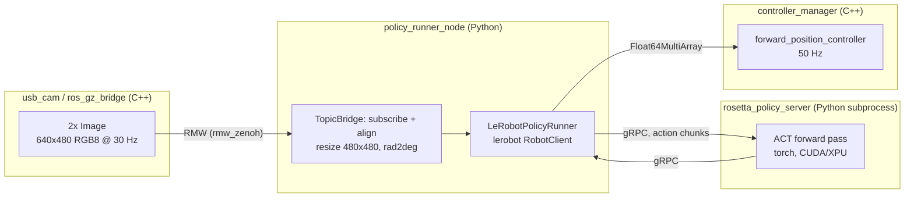
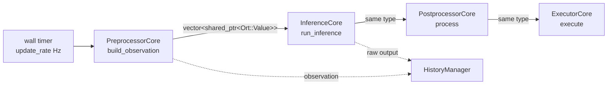
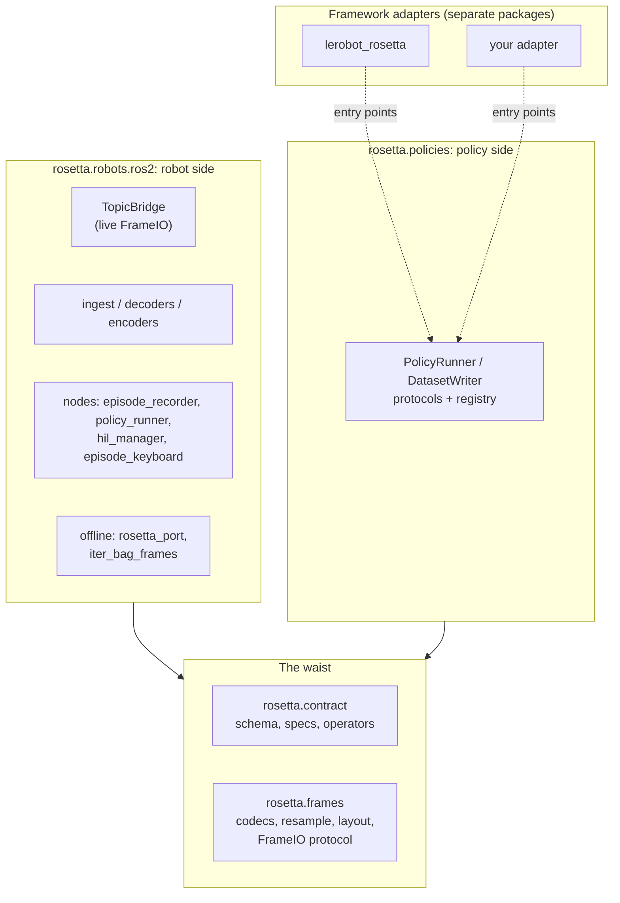
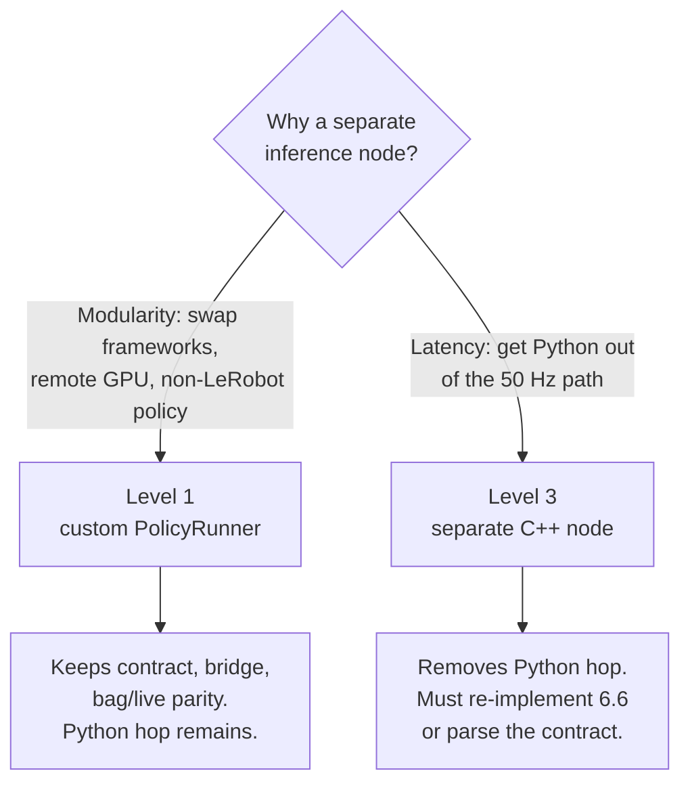
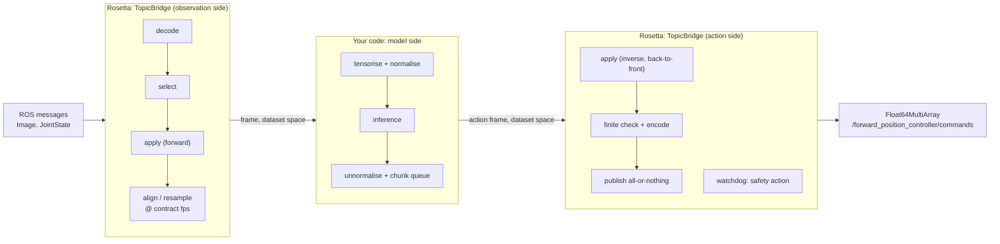
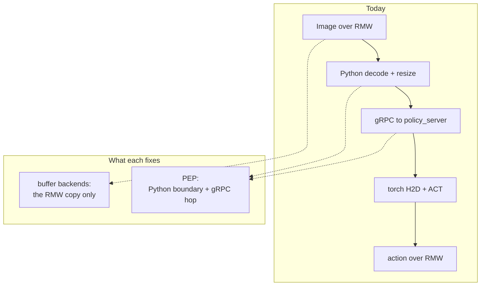

# C++ Policy Execution and Zero-Copy Buffers

An evaluation of two upstream efforts against this repository's deployment path:

1. **[`ros2_policy_execution_pipeline`](https://github.com/saikishor/ros2_policy_execution_pipeline)** (Sai Kishor Kothakota, PAL Robotics) — a C++ `pluginlib` pipeline for running a neural policy as a ROS 2 node, with an eye toward running it as a `ros2_control` controller.
2. **[`rosidl_buffer_backends`](https://github.com/ros2/rosidl_buffer_backends)** (ros2) — vendor storage backends for `rosidl::Buffer`, the zero-copy message-payload mechanism introduced in ROS 2 Lyrical Luth.

Both are C++, both are new, and neither is on RoboStack today. This document works out what they would actually buy us, what they would cost, and in what order they make sense.

> **Status: research, not a plan of record.** Nothing here has been built or benchmarked in this workspace. Every factual claim is sourced; the arithmetic is labelled as arithmetic.

> **Note on versions.** This document describes the workspace as of `main` @ `4d3564c`, which pins **Rosetta 0.2.0** (`dfd07e4`, with `lerobot-rosetta` 0.2.0 as the framework adapter) and **LeRobot 0.6.0**. An earlier draft was written against pre-0.2.0 Rosetta and LeRobot 0.5.1; the renames that came with the bump (`rosetta_client_node` → `policy_runner_node`, `from_tensor.clamp` → an `apply` operator pipeline) are catalogued in [Rosetta 0.2.0 Migration](rosetta-0.2-migration.md). The architectural argument did not change with the bump.

---

## Contents

- [1. Executive summary](#1-executive-summary)
- [2. What was inspected](#2-what-was-inspected)
- [3. Baseline: where the time goes today](#3-baseline-where-the-time-goes-today)
- [4. `ros2_policy_execution_pipeline`](#4-ros2_policy_execution_pipeline)
- [5. `rosidl_buffer_backends`](#5-rosidl_buffer_backends)
- [6. Substitution points: what a separate inference node can reuse](#6-substitution-points-what-a-separate-inference-node-can-reuse)
- [7. Building custom inference on Rosetta](#7-building-custom-inference-on-rosetta)
- [8. How the two fit together](#8-how-the-two-fit-together)
- [9. Recommendation](#9-recommendation)
- [10. Appendix: version and availability matrix](#10-appendix-version-and-availability-matrix)

---

## 1. Executive summary

**On `ros2_policy_execution_pipeline` (PEP).** It is a clean, small, well-documented four-stage plugin skeleton — preprocess → infer → postprocess → execute — and the architecture is a good fit for what this repo eventually wants. But it ships **zero concrete plugins**, it is a personal repository with no releases and no CI, and its inference stage is **synchronous on a wall timer**, which does not match action-chunked policies like ACT or any VLA. Adopting it today means writing all four plugins ourselves _and_ solving a problem it does not yet solve.

The harder blocker is upstream of PEP entirely: **PEP consumes ONNX models, and LeRobot has no ONNX export.** ([huggingface/lerobot#3146](https://github.com/huggingface/lerobot/issues/3146) is still open; export is roadmapped for LeRobot 0.7.0. This repo pins 0.6.0, and neither 0.6.0 nor the latest release, 0.6.1, ships an exporter.) Without an exported ACT graph there is nothing for an `InferenceCore` to load.

**On `rosidl_buffer_backends`.** Two hard gates, both verified:

- **The RMW gate.** Buffer-aware pub/sub landed in `rmw_zenoh_cpp` **0.10.5**. RoboStack Lyrical publishes **0.10.4** only. This repo sets `RMW_IMPLEMENTATION=rmw_zenoh_cpp`. **Zero-copy buffer transport cannot engage in this workspace today, at all.** `rmw_fastrtps_cpp` 9.4.8 on RoboStack _does_ support it, so switching RMW is the only way to exercise the feature right now.
- **The payload gate.** Even with the RMW sorted, this repo's frames are 640×480 RGB ≈ **0.88 MiB**. The upstream benchmark's _smallest_ data point is 7.9 MiB, and — as [§5.5](#55-reading-the-upstream-benchmark-honestly) shows by reading the benchmark's source — those headline "3.3×–5.8×" numbers are **not a transport benchmark**: the CPU column also renders on CPU. They cannot be extrapolated down to our payloads as-is.

There is a third, structural point that applies to both: **this repository currently contains no C++ source at all.** Every package is `ament_cmake` install-only or `ament_python`. Adopting either technology introduces the first compiled package, the first plugin library, and a meaningfully larger build surface into a workspace whose current value proposition is "`pixi install && pixi run build`".

**On keeping Rosetta.** A separate inference engine does **not** cost us the Rosetta stack. Since 0.2.0 the policy framework is a named entry-point plugin, so recording, `rosetta_port`, the contract and the topic bridge are all framework-agnostic — only `policy_runner_node`'s backend is coupled to LeRobot. [§6](#6-substitution-points-what-a-separate-inference-node-can-reuse) works through three levels of substitution, and surfaces an option missing from the list below: **if the goal is modularity rather than latency, a ~300-line Python `PolicyRunner` plugin (Level 1) achieves it with no C++, no ONNX export, and no loss of train/serve parity.** Rule that out explicitly before committing to PEP-B.

**Bottom line.** The latency in the current deployment path is dominated by a Python process boundary and a gRPC hop, not by ROS transport. PEP attacks that; buffer backends do not. Sequence accordingly: **PEP-shaped work first, buffer backends later and only if payloads grow.**

| Option                                                                                                                  | Payoff                                                     | Effort                          | Risk                                                                              | Verdict                                              |
| ----------------------------------------------------------------------------------------------------------------------- | ---------------------------------------------------------- | ------------------------------- | --------------------------------------------------------------------------------- | ---------------------------------------------------- |
| **PEP-B** — vendor PEP, write four SO-ARM plugins, run as a standalone node beside Rosetta                              | High (removes Python + gRPC hops)                          | High                            | Medium (blocked on ONNX export)                                                   | **Recommended target**, once ONNX export exists      |
| **PEP-C** — host the pipeline inside a `ros2_control` controller                                                        | Highest                                                    | Very high                       | High (PEP API incompatible today, see [§4.5](#45-gaps-found-by-reading-the-code)) | Right long-term shape; premature now                 |
| **PEP-A** — track upstream, prototype ONNX export only                                                                  | Low direct                                                 | Low                             | Low                                                                               | **Do this now**                                      |
| **ROS-L1** — custom `PolicyRunner` entry-point plugin (see [§6.3](#63-level-1--your-own-policyrunner-keeping-the-node)) | Framework independence, remote inference — **not** latency | Low                             | Low                                                                               | **Do this if the goal is modularity**                |
| **BUF-1** — bump `rmw_zenoh_cpp` to ≥ 0.10.5 on RoboStack                                                               | Enables everything else                                    | Low–medium (upstream packaging) | Low                                                                               | **Do this now**; it is a prerequisite, not a feature |
| **BUF-3** — build `cuda_buffer_backend` from source, enable CUDA path                                                   | Low at current payloads                                    | High                            | Medium                                                                            | Defer until after PEP-B                              |

---

## 2. What was inspected

Everything below was read directly from source, not from summaries.

| Thing                                           | Where                                                 | State when read                                                                                                                 |
| ----------------------------------------------- | ----------------------------------------------------- | ------------------------------------------------------------------------------------------------------------------------------- |
| `ros2_policy_execution_pipeline`                | `github.com/saikishor/ros2_policy_execution_pipeline` | branch `master`, head `9e3478a`, pushed 2026-08-06                                                                              |
| `rosidl_buffer_backends`                        | `github.com/ros2/rosidl_buffer_backends`              | branch `main`, head `d7cd964`                                                                                                   |
| `rosidl_buffer_backends_tutorials`              | `github.com/ros2/rosidl_buffer_backends_tutorials`    | branch `main`, tag `0.1.0`                                                                                                      |
| `onnxruntime_vendor`                            | `github.com/ros-controls/onnxruntime_vendor`          | branch `main`                                                                                                                   |
| Rosetta                                         | `github.com/iblnkn/rosetta`                           | commit `dfd07e4` (0.2.0), the pin in [`pai.repos`](../../pai.repos). Upstream `HEAD` (`294136d`) is ahead only by docs commits. |
| `lerobot_rosetta` (reference framework adapter) | `github.com/iblnkn/lerobot-rosetta`                   | commit `1ea49d6`, version `0.2.0`, which is both the pin and upstream `HEAD`                                                    |
| LeRobot                                         | PyPI `lerobot`                                        | `0.6.0` as pinned in [`pixi.toml`](../../pixi.toml). The latest release is `0.6.1`.                                             |
| This workspace                                  | —                                                     | `main` @ `4d3564c` (Bump to Rosetta 0.2.0, #83)                                                                                 |

Package availability was checked against the `robostack-lyrical` and `conda-forge` channels via the prefix.dev API; ROS release status against [`ros/rosdistro`](https://github.com/ros/rosdistro) `lyrical/distribution.yaml`.

---

## 3. Baseline: where the time goes today

Any claim that a new technology "improves performance" needs a baseline. Here is ours.

### 3.1 The deployment path

From [`docs/demos/end-to-end-pipeline.md`](../demos/end-to-end-pipeline.md), [`policy_runner.yaml`](../../pai_data_collection/config/rosetta/policy_runner.yaml), and the pinned Rosetta and `lerobot-rosetta` source (`lerobot_rosetta/policy_runner.py`, `lerobot_rosetta/policy_server.py`), deploying a trained policy looks like this:



The observation crosses **two** process boundaries per inference step, and is fully serialised at each: once over RMW into Python, once over gRPC into the policy server. In between it is decoded to NumPy, resized, and converted to a torch tensor — all under the Python GIL.

`policy_runner_node` is a framework-agnostic `LifecycleNode`. It loads the `framework: lerobot` plugin, `LeRobotPolicyRunner` from `lerobot-rosetta`. At configure time that runner launches `lerobot_rosetta.policy_server` as a **subprocess** (`launch_local_server: true`). The subprocess is a thin wrapper around LeRobot 0.6.0's `async_inference.PolicyServer` that preloads the model before binding its gRPC port. Per goal, the runner then drives a `lerobot.async_inference.RobotClient` whose observations and actions go through Rosetta's `TopicBridge`. Action chunking is configured in `policy_runner.yaml`: `actions_per_chunk: 30` (the adapter's own default is 50) and `chunk_size_threshold: 0.95`.

The 0.2.0 restructuring moved this code around without changing its runtime shape. The path still has the same two process boundaries and the same gRPC hop as it did before the bump.

### 3.2 Payload arithmetic

From [`pai_bringup/config/cameras/usb_cam_wrist.yaml`](../../pai_bringup/config/cameras/usb_cam_wrist.yaml) and [`pai_data_collection/config/rosetta/so_arm101.yaml`](../../pai_data_collection/config/rosetta/so_arm101.yaml):

| Quantity                                    | Value                                    |
| ------------------------------------------- | ---------------------------------------- |
| Camera resolution / encoding                | 640 × 480, RGB8                          |
| Bytes per frame                             | 640 × 480 × 3 = **921,600 B ≈ 0.88 MiB** |
| Camera rate                                 | 30 Hz                                    |
| Cameras                                     | 2 (wrist + static)                       |
| Aggregate image bandwidth                   | ≈ **55 MB/s**                            |
| Network input after contract resize         | 480 × 480 × 3 = 691,200 B                |
| `observation.state`                         | 6 × `float64` = 48 B (negligible)        |
| Contract FPS / `ros2_control` `update_rate` | 50 Hz / 50 Hz                            |

The state half of the observation is free. **All of the transport cost is images**, and each image is well under one mebibyte.

### 3.3 Why this matters for the rest of the document

A single 0.88 MiB `memcpy` at a realistic ~10 GB/s costs on the order of **0.09 ms**. Even four or five such copies across the whole path land in the **sub-millisecond** range per frame. For comparison, LeRobot's own cadence instrumentation for a 30 Hz ACT-class rollout reports `infer` at ~5 ms mean with a 40 ms worst case, and `observe` at ~3 ms ([LeRobot deployment docs](https://huggingface.co/docs/lerobot/main/inference)).

So the honest framing is: **ROS-level data movement is not this repo's bottleneck at current resolutions.** The Python boundary, the gRPC hop, and the model itself are. That single observation drives the entire recommendation in [§9](#9-recommendation).

---

## 4. `ros2_policy_execution_pipeline`

### 4.1 What it is

Two `ament_cmake` packages, Apache-2.0, ~1,100 lines of C++ total.

**`ros2_policy_execution_core`** — a header-only `INTERFACE` library defining four abstract base classes, each a `pluginlib` base:

| Class               | Key method                                     | Role                                                                                     |
| ------------------- | ---------------------------------------------- | ---------------------------------------------------------------------------------------- |
| `PreprocessorCore`  | `build_observation(now)` → `get_observation()` | Collect observations from registered providers, concatenate, track per-provider data age |
| `InferenceCore`     | `run_inference(obs, out)`                      | Run the network. **The only framework-specific stage.**                                  |
| `PostprocessorCore` | `process(inference_output)`                    | Scale, limit, smooth raw policy output into commands                                     |
| `ExecutorCore`      | `execute(commands)`                            | Publish to a topic, or write `ros2_control` command interfaces                           |

Plus `preprocessor_support.hpp`, contributed by Julia Jia, holding two helpers: `ObservationProviderRegistry` (named providers called in registration order, with declared segment names validated against what the provider returns) and `HistoryManager` (bounded observation/action deques, newest at the front).

**`ros2_policy_execution_pipeline`** — a `PolicyExecutionPipeline` class plus a `policy_execution_pipeline_node` executable. `init()` reads four plugin-name parameters, loads each via a `pluginlib::ClassLoader`, applies history config, calls `configure(node)` on all four, and starts a wall timer at `update_rate` (default 100 Hz). Each tick runs the four stages in order and, on success, pushes the observation and the **raw inference output** (not the postprocessed commands) into history.

Failure handling is thoughtful: any stage returning `false`, or any exception, aborts only that cycle with a throttled log, and history is not updated — so a bad cycle cannot poison the buffers.



### 4.2 The `Ort::Value` data contract — what it is and is not

Every stage passes `std::vector<std::shared_ptr<Ort::Value>>`. The README is careful about why, and the reasoning is sound enough to restate:

> The dependency on ONNX Runtime is a dependency on its **datatype** (`Ort::Value`), not on ONNX as the inference framework.

`Ort::Value` is used as a backend-agnostic tensor container because it natively represents every element type the pipeline needs (`float`, `uint8_t` for images, `int64_t`, `bool`, `float16`), offers type-safe typed accessors, and — via `shared_ptr<Ort::Value>` plus ORT's allocator — solves history-buffer ownership without copying between stages. A TensorRT or LibTorch `InferenceCore` is explicitly supported: convert in, run, convert out.

**The cost is real and stated plainly by the author:** ONNX Runtime becomes a compile-time dependency of _every_ plugin, including framework-agnostic preprocessors, postprocessors, and their tests. For us that means `onnxruntime_vendor` (or conda `onnxruntime-cpp`) in the dependency graph of any plugin we write, even a trivial one that only publishes a `Float64MultiArray`.

Git history shows this was a deliberate, late pivot: PR #4 "Use ONNX datatype for handshake" was merged, while PR #3, which proposed a separate tensor-adapter package, was closed. PR #2 ("Shared datatype") is still open. The contract is therefore **settled but young**.

### 4.3 What it does _not_ provide

Worth being blunt, because the READMEs are easy to read optimistically:

- **No concrete plugins.** Neither package ships a single implementation. `init()` throws `pluginlib::LibraryLoadException` and the node exits 1 until you supply four.
- **No launch files, no example config beyond a README snippet, no integration tests.** Testing is two `ament_add_gmock` suites exercising the base classes through hand-rolled test doubles.
- **No CI.** The repository contains a `.pre-commit-config.yaml` and nothing else — no `.github/workflows`.
- **No release.** Not in `ros/rosdistro`, so no binary packages on any platform, and no versioned ABI to depend on.

### 4.4 Maturity assessment

| Signal                                                                                                                                                                                                                              | Reading                                                |
| ----------------------------------------------------------------------------------------------------------------------------------------------------------------------------------------------------------------------------------- | ------------------------------------------------------ |
| Personal namespace (`saikishor/`), not `ros-controls/`                                                                                                                                                                              | Incubating; not yet an org-supported project           |
| Created 2026-03-30, last push 2026-08-06, 7 stars                                                                                                                                                                                   | Early, low external usage                              |
| No root `LICENSE` (Apache-2.0 only in per-package `LICENSE` files)                                                                                                                                                                  | Minor hygiene gap; licence intent is nonetheless clear |
| `version` `0.0.0` on both packages                                                                                                                                                                                                  | Explicitly pre-release                                 |
| Author is a `ros2_control` maintainer; co-presenting the [ROSCon 2026 workshop](https://control.ros.org/rolling/doc/resources/roscon2026_workshop.html) "Scaling ros2_control: From Async Hardware Drivers to RL Inference Engines" | Strong signal this is headed for `ros-controls`        |

That last row matters. The workshop — with Bence Magyar, Christoph Fröhlich, Denis Štogl and Marq Rasmussen alongside the author — covers "deploying RL Policy Models (via ONNX/Torch) as non-blocking controllers", "thread-safe data exchange", and "managing inference jitter". Those are precisely the gaps listed below. The workshop repository ([`ros-controls/roscon2026_control_workshop`](https://github.com/ros-controls/roscon2026_control_workshop)) currently holds only a placeholder `sleepy_controller`, so the material is still in flight.

**Implication for us:** this API is likely to change, possibly substantially, before it stabilises. That is an argument for tracking and prototyping, not for vendoring it into the default launch path.

### 4.5 Gaps found by reading the code

These are not in the READMEs. They came out of reading the headers and `policy_execution_pipeline.cpp`, and each is a concrete integration obstacle.

**(a) Inference is synchronous on the timer — no decoupling of inference rate from control rate.**

`PolicyExecutionPipeline::update()` calls `inference_->run_inference(...)` inline, in the wall-timer callback. A slow forward pass therefore blocks the timer and delays the next cycle. At our 50 Hz control rate the budget is 20 ms; ACT-class inference of ~5 ms mean / ~40 ms worst case would already overrun on the tail, and SmolVLA or π0 would not fit at all.

This also does not match **action chunking**, which is how the current deployment works (`actions_per_chunk: 30`). A chunked policy runs the network once per ~30 control steps and drains a queue in between. PEP has no queue concept: it runs all four stages every tick and pushes history every tick.

You can work around it — have `InferenceCore` return a cached chunk element and only invoke the network when the queue drains — but then `run_inference` lies about what it did, and `set_previous_actions()` records a replayed action as if it were fresh. That is a design mismatch, not a coding detail. It is exactly the "non-blocking controllers / inference jitter" topic of the workshop, so a fix is plausibly coming, but it is not here yet.

**(b) `configure()` takes `rclcpp::Node::SharedPtr`, which a `ros2_control` controller cannot supply.**

All four base classes declare:

```cpp
virtual void configure(const rclcpp::Node::SharedPtr & node) = 0;
```

`controller_interface::ControllerInterfaceBase::get_node()` returns `std::shared_ptr<rclcpp_lifecycle::LifecycleNode>`. These types are not interchangeable and neither derives from the other. So the "run the pipeline inside a controller" story that the `ExecutorCore` documentation gestures at — holding `hardware_interface::LoanedCommandInterface` references — **cannot be implemented against the current API** without upstream changes (taking node _interfaces_, or adding a lifecycle overload). This is the single biggest obstacle to option PEP-C.

**(c) Observation providers have a borrowed-reference contract with no synchronisation.**

`ObservationData` holds `const std::vector<OrtValueSharedPtr> & values` — a borrowed reference, with a documented contract that providers must use "stable pre-allocated storage and update contents in place". But providers are invoked from the **timer thread**, while a ROS subscription writes that storage from an **executor thread**. With a single-threaded executor the two are serialised and it is safe. With a `MultiThreadedExecutor`, or a subscription on a separate callback group, it is a data race. PEP provides no locking and no `realtime_tools::RealtimeBuffer`. Any plugins we write must handle this themselves, and must document the executor assumption.

**(d) `build_observation()` throws rather than returning `false` on bad data.**

Both signalling styles exist: the method returns `bool`, but the base implementation throws `std::runtime_error` for an empty provider result, a future timestamp, or a segment-count mismatch. The pipeline's `catch` is load-bearing and the source comments say so. Not a bug — but it means one stale timestamp costs a whole cycle, and at 50 Hz a persistently stale camera silently produces a dead pipeline with only a throttled log.

### 4.6 The ONNX export blocker

PEP's natural `InferenceCore` loads an `.onnx` file. Our policies are LeRobot checkpoints.

**LeRobot does not export to ONNX.** [Issue #3146](https://github.com/huggingface/lerobot/issues/3146) is still open, as is PR #3521 ("Feat: onnx export cli"). Export is on the 0.7.0 roadmap. This repo pins `lerobot==0.6.0`, and neither 0.6.0 nor 0.6.1 (the latest release, 2026-08-03) includes an exporter. The issue reports that `torch.onnx.export` works for ACT and Diffusion architectures "with some attention to dynamic axes", and that the hard part is policy-specific pre/post-processing — action chunking, denoising loops — not the graph itself.

Three ways through, in increasing order of commitment:

1. **Hand-roll an ACT export.** Feasible per the issue, and ACT is the policy our [pre-trained demo](../demos/pretrained-demo.md) already uses. We would own normalisation statistics, the chunk dimension, and dynamic axes ourselves, plus a numerical-equivalence test against the torch checkpoint. **This is the natural first experiment, and it is independent of every other decision in this document.**
2. **Skip ONNX; write a LibTorch `InferenceCore`.** Load a TorchScript-traced checkpoint and convert `Ort::Value` ↔ `at::Tensor` inside the stage. Keeps LeRobot's exact operator semantics. Cost: `libtorch_vendor` (or conda `libtorch`) _plus_ ONNX Runtime, because the `Ort::Value` contract is unavoidable.
3. **Wait for LeRobot 0.7.0.** Zero effort, but no release date, and it means another LeRobot bump. The 0.5.1 → 0.6.0 bump ([migration notes](rosetta-0.2-migration.md)) shows what that costs here: it solved on Python 3.14 only through the existing `numpy` and `draccus` dependency overrides in `pixi.toml`, and it was gated on `lerobot-rosetta`'s API requirements. A 0.7.0 bump would need the same revalidation and a matching `lerobot-rosetta` release.

### 4.7 Integration alternatives

#### PEP-A — Track upstream; prototype ONNX export only

Add nothing to the build. Open an issue tracking PEP's move to `ros-controls`, and separately prototype ACT → ONNX export with a numerical-equivalence test against the torch checkpoint.

- **Effort:** low. **Risk:** none. **Payoff:** de-risks every other option; the export is the long-pole item and is useful regardless of whether we ever adopt PEP.

#### PEP-B — Vendor PEP; write four plugins; run as a node beside Rosetta

Add PEP to [`pai.repos`](../../pai.repos) at a pinned commit, add a new `pai_policy_execution` C++ package exporting four plugins, and launch it as an alternative deployment backend. Rosetta stays the default; the new path is opt-in.

What the four plugins would be, concretely:

| Stage         | Plugin                     | Responsibility                                                                                                                                                                                                                        |
| ------------- | -------------------------- | ------------------------------------------------------------------------------------------------------------------------------------------------------------------------------------------------------------------------------------- |
| Preprocessor  | `SoArmPreprocessor`        | Register three providers: `/joint_states` (6 positions, joint-name ordered per the contract), `/wrist_camera/image_raw`, `/static_camera/image_raw`. Resize to 480×480 and build `uint8` image tensors plus a `float32` state tensor. |
| Inference     | `LeRobotOnnxInference`     | Load the exported ACT graph; run with the CUDA (or XPU) execution provider.                                                                                                                                                           |
| Postprocessor | `ActionChunkPostprocessor` | Hold the chunk queue. Apply `deg2rad`, then clamp to `[-3.14159, 3.14159]`, which is the inverse of the action's `apply: [clamp, rad2deg]` pipeline in the contract (see [§6.6](#66-what-level-3-actually-has-to-re-implement)).      |
| Executor      | `ForwardCommandExecutor`   | Publish `Float64MultiArray` to `/forward_position_controller/commands`.                                                                                                                                                               |

Note how much of this **re-implements the Rosetta contract in C++**: joint selection and ordering, unit conversion, image resize, clamping, and the `hold` safety behaviour all currently live in `so_arm101.yaml`. Duplicating them in compiled plugins creates two sources of truth for the ROS ↔ policy mapping — a real maintenance hazard, and worth designing against explicitly (for example, by having the plugins parse the same contract YAML).

- **Effort:** high — first C++ package in the repo, ~1,000+ lines, plus CUDA/ORT in the pixi environment.
- **Risk:** medium — blocked on ONNX export; PEP API may churn; chunking mismatch from [§4.5(a)](#45-gaps-found-by-reading-the-code) must be solved.
- **Payoff:** high — removes the Python boundary _and_ the gRPC hop, the two dominant costs in [§3](#3-baseline-where-the-time-goes-today). This is also the configuration in which buffer backends would finally have something to accelerate.

#### PEP-C — Host the pipeline inside a `ros2_control` controller

The end state everyone is aiming at: the policy runs in the controller manager's update loop, and `ExecutorCore` writes `LoanedCommandInterface` directly. No topic hop, no controller round-trip, deterministic scheduling.

**Not currently implementable** — see [§4.5(b)](#45-gaps-found-by-reading-the-code). It needs PEP to accept node interfaces or a `LifecycleNode`, and it needs the async-inference story from [§4.5(a)](#45-gaps-found-by-reading-the-code), since blocking a real-time controller update on a forward pass is not acceptable.

- **Verdict:** right long-term shape, premature to attempt. Revisit after the ROSCon 2026 workshop material lands.

#### PEP-D — Adopt the architecture, not the dependency

Write our own four-stage pipeline in `pai_*` using plain `std::vector<float>` or `at::Tensor`, skipping `Ort::Value` and therefore ONNX Runtime.

- **Pro:** no ONNX Runtime in the dependency graph of every plugin; no coupling to a pre-release API.
- **Con:** we own it forever, and we forfeit the upstream trajectory — the `ros-controls` ecosystem, the workshop material, and any plugins the community writes. Given that the architecture's whole value is the shared plugin contract, reimplementing it privately discards most of the point.
- **Verdict:** only if PEP stalls or its API proves unworkable for us.

#### PEP-E — Contribute upstream

Offer SO-ARM101 as PEP's reference demo and push the four plugins upstream (to PEP, or to `ros-controls` once it moves there).

This is more plausible than it first looks. `onnxruntime_vendor` is maintained by **Julia Jia**, who also authored this repo's `pixi.toml` and PEP's `preprocessor_support.hpp`, alongside the `ros2_control` maintainers. More tellingly, `onnxruntime_vendor`'s `CMakeLists.txt` carries an explicit escape hatch:

```cmake
# Handle the case in which ONNX Runtime should not be vendored, for example in
# conda-forge/robostack where a recent enough onnxruntime package is available
# in the distribution and there is no need to vendor it.
if(DEFINED AMENT_VENDOR_POLICY AND (AMENT_VENDOR_POLICY STREQUAL "NEVER_VENDOR" OR ...))
  ament_export_dependencies(onnxruntime)
  ament_package()
  return()
endif()
```

That branch exists for workspaces exactly like this one. conda-forge ships `onnxruntime-cpp` 1.29.0, so the RoboStack path is already anticipated — we would set `AMENT_VENDOR_POLICY=NEVER_VENDOR` in [`colcon_defaults.yaml`](../../colcon_defaults.yaml) and add `onnxruntime-cpp` to `pixi.toml`. (Worth verifying that conda's `onnxruntime-cpp` exports a CMake config providing the `onnxruntime::onnxruntime` target that PEP links against, and that a CUDA-enabled build variant is selectable.)

- **Verdict:** pursue opportunistically alongside PEP-B. Low marginal cost, high strategic value.

---

## 5. `rosidl_buffer_backends`

### 5.1 What changed in Lyrical

From the [Lyrical Luth release notes](https://github.com/ros2/ros2_documentation/blob/rolling/source/Releases/Release-Lyrical-Luth.rst):

> All `uint8[]` fields now have the type `rosidl::Buffer<uint8_t>` in C++ instead of `std::vector<uint8_t>`.

This is a **distro-wide C++ type change**, not an opt-in feature. `sensor_msgs::msg::Image::data` is a `rosidl::Buffer<uint8_t>` in Lyrical. The payload's _storage_ is delegated to a registered `rosidl::BufferBackend` plugin, so a publisher can allocate the payload in accelerator memory and a co-located subscriber can read it without a host copy — with automatic fallback to the normal CPU path when the endpoints are not compatible.

The core machinery lives in [`ros2/rosidl`](https://github.com/ros2/rosidl): `rosidl_buffer`, `rosidl_buffer_backend`, `rosidl_buffer_backend_registry`, `rosidl_buffer_py`. The vendor backends live in [`ros2/rosidl_buffer_backends`](https://github.com/ros2/rosidl_buffer_backends), released in Lyrical at `0.1.2-1`.

NVIDIA describes the feature as built on NITROS from Isaac ROS and developed with the ROS community.

### 5.2 What is in the repository

| Package                    | What it is                                                                                                                                                                   |
| -------------------------- | ---------------------------------------------------------------------------------------------------------------------------------------------------------------------------- |
| `cuda_buffer`              | Core CUDA implementation: VMM memory pool, IPC manager, host endpoint manager, and the `allocate_buffer` / `from_input_buffer` / `from_output_buffer` / `to_buffer` user API |
| `cuda_buffer_backend`      | The `pluginlib` backend (`rosidl::BufferBackend`, type string `"cuda"`), endpoint discovery, descriptor serialisation                                                        |
| `cuda_buffer_backend_msgs` | `CudaBufferDescriptor.msg` — the small message actually sent over the wire                                                                                                   |
| `qc_buffer_backend`        | Qualcomm equivalent, HTP↔CPU zero-copy over dma-buf                                                                                                                          |
| `tensor_msgs`              | `ExperimentalTensor.msg` — a DLPack-aligned tensor message                                                                                                                   |
| `torch_conversions`        | Header-only `ExperimentalTensor` ↔ `at::Tensor` bridge, plus DLPack import/export                                                                                            |
| `libtorch_vendor`          | Downloads and installs prebuilt LibTorch                                                                                                                                     |

Note the naming: `ExperimentalTensor` is experimental **on purpose** — its README says the schema "may change before it is renamed to `Tensor` and stabilized".

### 5.3 How the CUDA path works

Worth understanding, because its preconditions determine whether it can ever fire for us.

The publisher allocates the payload from a CUDA Virtual Memory Management pool and writes to it via a `WriteHandle`, whose destructor records a CUDA write event. What travels over RMW is not the pixels but a **`CudaBufferDescriptor`** — `{size, device_id, vmm_pid, vmm_block_id, vmm_socket_path, ipc_uid, ipc_event_handle}`. On first receipt of a given `(pid, block_id)` pair the subscriber connects to a per-block Unix domain socket and receives the exported VMM file descriptor via `SCM_RIGHTS`, then imports and maps it; every subsequent message with the same pair is a cache hit with no FD round-trip. A shared-memory refcount plus a per-publish UID prevents the publisher from recycling a block while a subscriber still holds it, and lets a late subscriber detect staleness.

Three process-wide singletons back this: `CudaMemoryPool`, `CudaVmmIPCManager`, and a `HostEndpointManager` registry in `/dev/shm` recording each endpoint's `(pid, gid, device, uid, intra-process)`.

**The optimised path requires all of:** same host, same CUDA device, same Linux user, and both endpoints advertising the `"cuda"` backend. Anything else — different GPU, different user, remote host, VMM unavailable — falls back to CPU automatically, via `to_cpu()`.

### 5.4 The two gates

#### Gate 1 — the RMW (hard blocker today)

| RMW                | Buffer support since    | RoboStack Lyrical ships | Usable?   |
| ------------------ | ----------------------- | ----------------------- | --------- |
| `rmw_fastrtps_cpp` | **9.4.6** (2026-04-09)  | **9.4.8**               | ✅ yes    |
| `rmw_zenoh_cpp`    | **0.10.5** (2026-07-22) | **0.10.4**              | ❌ **no** |

`rmw_zenoh` support came from [PR #930](https://github.com/ros2/rmw_zenoh/pull/930) (merged to `rolling` 2026-06-04, backported to `lyrical` as #987) and first shipped in 0.10.5. RoboStack has not picked that up: a channel query for `ros-lyrical-rmw-zenoh-cpp` on `robostack-lyrical` returns **0.10.4 only**, across all 15 build variants, which matches the pin in our `pixi.lock`.

This repository sets `RMW_IMPLEMENTATION=rmw_zenoh_cpp` in `pixi.toml` `[activation.env]`. **Therefore, as the workspace stands, buffer backends cannot engage. Every message would take the CPU fallback path.**

Two encouraging notes: the core infrastructure is _already installed_ — `pixi.lock` contains `ros-lyrical-rosidl-buffer`, `-rosidl-buffer-backend`, `-rosidl-buffer-backend-registry` and `-rosidl-buffer-py`, all at 5.2.1 — and `ros-lyrical-rmw-fastrtps-cpp` 9.4.8 is available, so a FastRTPS benchmark is possible today without any RoboStack work.

#### Gate 2 — package availability

Checked against `robostack-lyrical`:

| Package                                                                                        | On RoboStack?                                             |
| ---------------------------------------------------------------------------------------------- | --------------------------------------------------------- |
| `rosidl_buffer`, `rosidl_buffer_backend`, `rosidl_buffer_backend_registry`, `rosidl_buffer_py` | ✅ 5.2.1, already in our lock                             |
| `cuda_buffer`, `cuda_buffer_backend`, `cuda_buffer_backend_msgs`                               | ❌ absent                                                 |
| `tensor_msgs`, `torch_conversions`, `libtorch_vendor`                                          | ❌ absent                                                 |
| `onnxruntime_vendor`                                                                           | ❌ absent (conda `onnxruntime-cpp` 1.29.0 exists instead) |

All of these _are_ released as Lyrical debs on `build.ros2.org`, so this is a RoboStack packaging gap, not an upstream one. In our workspace they would have to be source builds via `pai.repos` — and `cuda_buffer` additionally needs a CUDA Toolkit ≥ 11.8, which `pixi.toml` does not currently provide in any form.

### 5.5 Reading the upstream benchmark honestly

The [`robot_arm_demo` tutorial](https://github.com/ros2/rosidl_buffer_backends_tutorials) publishes reference numbers, measured inter-process, headless, over FastRTPS:

| Resolution  | Frame size | `torch_conversions` + CUDA IPC | CPU fallback |
| ----------- | ---------: | -----------------------------: | -----------: |
| 1920 × 1080 |    7.9 MiB |                      116.6 FPS |     35.5 FPS |
| 2560 × 1440 |   14.1 MiB |                       90.6 FPS |     21.3 FPS |
| 3840 × 2160 |   31.6 MiB |                       59.5 FPS |     10.3 FPS |

Converted to per-frame time, the gap is strikingly linear in payload size — 19.6 ms, 35.9 ms and 80.3 ms respectively, i.e. ≈ **2.5 ms per MiB** at all three points.

**But this is not a transport benchmark, and it should not be cited as one.** Reading `robot_arm_demo/src/renderer_node.cpp`, the `use_cuda` parameter selects the **renderer's device**:

```cpp
auto device = use_cuda_ ? torch::Device(torch::kCUDA) : torch::Device(torch::kCPU);
renderer_ = std::make_unique<RobotArmRenderer>(width_, height_, device);
```

and `robot_arm_compare.launch.py` sets `use_cuda: False` for the whole "CPU" column. So the CPU figures include **rendering an SDF scene with LibTorch on the CPU**, which is far slower than the same work on a GPU. The measured gap conflates GPU compute with zero-copy transport, in unknown proportion. The clean linearity in bytes is suggestive that transport dominates the difference — CPU rendering cost should also scale with pixel count, so the two are confounded rather than separable.

**Consequence for us:** we cannot extrapolate "2.5 ms per MiB" down to our 0.88 MiB frames and claim ≈ 2.2 ms/frame of savings. The honest statement is that the real transport-only benefit at our payload size is **unknown and smaller than the headline suggests**, and that a first-principles estimate ([§3.3](#33-why-this-matters-for-the-rest-of-the-document)) puts a single 0.88 MiB copy at ~0.09 ms. If this matters enough to act on, it needs a purpose-built transport-only benchmark — publisher and subscriber doing no work but the copy, CUDA path vs CPU path, at 640×480 and at 1280×720.

### 5.6 Why it delivers approximately nothing for the current pipeline

Set the RMW gate aside and assume Zenoh 0.10.5. The feature still would not fire, for a structural reason: **a zero-copy handoff needs both endpoints to opt in, and ours cannot.**

| Endpoint        | What it is                                                                        | Can it hold a CUDA buffer?                                                                                                         |
| --------------- | --------------------------------------------------------------------------------- | ---------------------------------------------------------------------------------------------------------------------------------- |
| Producer (real) | `usb_cam` — V4L2 `mmap`, `mjpeg2rgb` decode on CPU                                | No. Writes host memory; would need upstream changes to allocate from a CUDA pool.                                                  |
| Producer (sim)  | `ros_gz_bridge parameter_bridge` — converts `gz.msgs.Image` → `sensor_msgs/Image` | No. Gazebo renders on the GPU but `gz-transport` hands the bridge a host buffer; a GPU-native bridge is substantial upstream work. |
| Consumer        | `policy_runner_node` (`TopicBridge`), in Python                                   | No. `rosidl_buffer_py` surfaces buffers to NumPy on the host; the GPU path is a C++ API.                                           |

So today: CPU producer → CPU consumer. The descriptor path would never be selected, and `on_discovering_endpoint` would return the fallback decision every time.

There is one nuance worth flagging even in the fallback case. Because Lyrical changed `uint8[]` to `rosidl::Buffer<uint8_t>` distro-wide, any C++ we write that touches `msg.data` uses the new type regardless of whether a backend is registered. **In this repo that is currently a non-issue — there is no C++ at all** — but it becomes a porting consideration the moment we add the first C++ package.

### 5.7 What would change the picture

In rough order of plausibility:

1. **A C++ inference consumer** (i.e. PEP-B lands). At minimum this removes the Python-side decode; and if we ever split preprocessing into its own GPU node, the _intra-pipeline_ hop between our own nodes is one we fully control — both ends could be CUDA-aware. This is the realistic first place a buffer backend earns its keep here.
2. **Higher resolution or more cameras.** The benefit scales with bytes. Going to 1280×720 (2.6 MiB/frame) roughly triples the payload; adding cameras multiplies it. At 640×480×2 we are firmly in the regime where it does not matter.
3. **A GPU-native image producer.** A CUDA-aware camera driver, or hardware JPEG decode landing straight in device memory. Nothing in our current stack does this.
4. **`tensor_msgs` for observations/actions between our own nodes.** `ExperimentalTensor` is DLPack-aligned, so PyTorch, ONNX Runtime, JAX and CuPy can all round-trip it. If the pipeline is ever split across processes, this is the right message type — with the caveat that the schema is explicitly unstable.

### 5.8 Integration alternatives

#### BUF-1 — Get `rmw_zenoh_cpp` ≥ 0.10.5 onto RoboStack

A prerequisite for everything else, and useful independently: 0.10.5 also carries non-buffer fixes. Concretely, this means a version bump in [`RoboStack/ros-lyrical`](https://github.com/RoboStack/ros-lyrical) — an upstream contribution, not a change in this repo.

- **Effort:** low–medium. **Risk:** low. **Do this now.**

#### BUF-2 — Benchmark on FastRTPS today

`rmw_fastrtps_cpp` 9.4.8 is already available and already supports buffer-aware pub/sub. Setting `RMW_IMPLEMENTATION=rmw_fastrtps_cpp` lets us measure the real thing without waiting for BUF-1. Pairs naturally with the purpose-built transport benchmark called for in [§5.5](#55-reading-the-upstream-benchmark-honestly).

- **Effort:** low. **Risk:** low (the repo's Zenoh default is unaffected). **Payoff:** turns speculation into numbers.

#### BUF-3 — Source-build `cuda_buffer_backend` and enable the CUDA path

Add `rosidl_buffer_backends` to `pai.repos`, add CUDA Toolkit to `pixi.toml`, build `cuda_buffer_backend`.

- **Effort:** high — CUDA in the pixi environment is a significant addition, and it hard-forks the "works on any Linux box" property that `pixi install` currently has.
- **Payoff:** near zero until a C++ CUDA-aware endpoint exists on both sides.
- **Verdict:** defer until after PEP-B.

#### BUF-4 — Contribute an XPU backend

This repo gained Intel XPU support in `80dc00c` (Tom Counihan, Intel). `rosidl_buffer_backends` ships CUDA and Qualcomm backends — **there is no Intel/SYCL/Level-Zero backend**. Given that an Intel contributor is already active here, this is a genuine upstream opportunity, and the Qualcomm backend (dma-buf based, ~600 lines) is a reasonable template.

- **Verdict:** speculative and well outside current scope, but worth raising with the Intel contributors. Flagged, not proposed.

---

## 6. Substitution points: what a separate inference node can reuse

Everything in [§4](#4-ros2_policy_execution_pipeline) describes building a _new_ inference path. The obvious follow-up question is what happens to the Rosetta stack we already have — do we lose recording, dataset conversion, and the contract, or can they survive alongside a different inference engine?

They survive. Rosetta 0.2.0 was restructured precisely so the policy framework is a swappable plugin, and understanding where its seams are changes the cost of every option in [§4.7](#47-integration-alternatives).

> This section describes Rosetta as pinned on `main` (`dfd07e4`, 0.2.0, schema v2). The renames and behavioural changes that came with 0.2.0 are catalogued separately in [Rosetta 0.2.0 Migration](rosetta-0.2-migration.md); this section is about the extension points, not the migration.

### 6.1 Rosetta's architecture: core systems and extension points

It is easy to think of Rosetta as "the thing that talks to LeRobot". Since 0.2.0 that is wrong in a useful way: the `rosetta` core package has **no LeRobot imports at all**. LeRobot is attached through two adapter packages, and everything framework-specific sits behind named plugin seams. That is what makes decoupling from LeRobot a matter of adding plugins rather than forking Rosetta.

#### The packages

Our [`pai.repos`](../../pai.repos) pins four repositories:

| Package                 | Role                                                                                                                                                                                                                  | Imports LeRobot? |
| ----------------------- | --------------------------------------------------------------------------------------------------------------------------------------------------------------------------------------------------------------------- | ---------------- |
| `rosetta`               | The core: contract, frames, ROS 2 robot interface, nodes, `rosetta_port`, and the plugin registries                                                                                                                   | **No**           |
| `rosetta_interfaces`    | ROS 2 actions and services (`RunPolicy`, `RecordEpisode`, `ManageEpisode`, `StartPolicy`, `StartHILEpisode`)                                                                                                          | No               |
| `lerobot_rosetta`       | **Rosetta → LeRobot.** Registers `LeRobotDatasetWriter` and `LeRobotPolicyRunner`, and ships `rosetta_policy_server` and the HIL `rosetta_classifier_server`                                                          | Yes              |
| `lerobot_robot_rosetta` | **LeRobot → Rosetta.** A LeRobot `Robot` plugin (`--robot.type=rosetta`) that makes a contract-described ROS 2 robot look like LeRobot hardware. `LeRobotPolicyRunner` drives the robot through it via `RobotClient`. | Yes              |

The two adapters point in opposite directions. `lerobot_rosetta` plugs LeRobot _into_ Rosetta's seams. `lerobot_robot_rosetta` plugs a Rosetta robot _into_ LeRobot's tooling.

#### Inside the core

The core is organised around a strict import rule, stated in `rosetta/contract/__init__.py`: the **waist** (`rosetta.contract` and `rosetta.frames`) is shared, and the **robot side** (`rosetta.robots`) and the **policy side** (`rosetta.policies`) each import only the waist, **never each other**.



| System                      | What it does                                                                                                                                                                                      | Key modules                                                                         |
| --------------------------- | ------------------------------------------------------------------------------------------------------------------------------------------------------------------------------------------------- | ----------------------------------------------------------------------------------- |
| **Contract**                | Parses and fully validates the YAML at load. Resolves each entry into a `StreamSpec` (channel → align → select → apply → key). Owns the operator registry.                                        | `contract/schema.py`, `contract/specs.py`, `contract/operators.py`                  |
| **Frames**                  | The message ↔ array boundary (codecs), the fixed-rate resampler (`StreamBuffer`), frame assembly and splitting (`FrameLayout`), and the `FrameIO` protocol                                        | `frames/codecs.py`, `frames/resample.py`, `frames/layout.py`, `frames/protocols.py` |
| **Robot interface (ROS 2)** | `TopicBridge` (live `FrameIO`), message ingest and timelines, built-in ROS codecs, and the lifecycle nodes. Offline, the bag porter replays bags through the **same** ingest and resampling code. | `robots/ros2/`                                                                      |
| **Policy seams**            | The `PolicyRunner` and `DatasetWriter` protocols, plus the registry that resolves them by name                                                                                                    | `policies/protocols.py`, `policies/registry.py`                                     |

The three layers from a deployment point of view:

| Layer         | Pieces                                                          | Framework-coupled?                                                                  |
| ------------- | --------------------------------------------------------------- | ----------------------------------------------------------------------------------- |
| **Offline**   | `episode_recorder_node` (bags), `rosetta_port` (bags → dataset) | No. The dataset format comes from a `DatasetWriter` plugin chosen by `--framework`. |
| **The waist** | The contract + `TopicBridge`: topics ↔ frames, both directions  | **No.** This is the part worth keeping, whatever you do with inference.             |
| **Online**    | `policy_runner_node` + a `PolicyRunner` plugin                  | Yes, and it is the _only_ inference-coupled piece.                                  |

#### The extension points

Rosetta has four open registries, all discovered through setuptools entry points: installing a package that advertises one is enough. It also has one protocol-only seam and one closed seam.

| Seam                | Mechanism                                                                                                                                                                                                         | What you provide                                                                                                                     | Selected by                                                        | Today                                                                                                                                                              |
| ------------------- | ----------------------------------------------------------------------------------------------------------------------------------------------------------------------------------------------------------------- | ------------------------------------------------------------------------------------------------------------------------------------ | ------------------------------------------------------------------ | ------------------------------------------------------------------------------------------------------------------------------------------------------------------ |
| **`PolicyRunner`**  | Entry-point group `rosetta.policy_runners`: a zero-argument class, checked structurally                                                                                                                           | Online inference: control loop, model, model-side pre/post ([§7.1](#71-what-the-contract-and-topicbridge-handle-and-what-they-dont)) | `policy_runner_node`'s `framework` parameter                       | `lerobot`                                                                                                                                                          |
| **`DatasetWriter`** | Entry-point group `rosetta.dataset_writers`: a zero-argument class, checked structurally                                                                                                                          | Offline dataset format: `open` / `add_frame` / `save_episode` / `discard_episode` / `finalize`                                       | `rosetta_port --framework <name>`                                  | `lerobot`                                                                                                                                                          |
| **Operators**       | Entry-point group `rosetta.operators`: a module whose `@register_operator` classes declare an `Invertibility` tier                                                                                                | New `apply:` transforms. `BIJECTIVE` ones must pass a round-trip check at load.                                                      | Name in the contract's `apply:` list                               | `rad2deg`, `resize`, `clamp` (built in)                                                                                                                            |
| **Codecs**          | Entry-point group `rosetta.codecs`: a module of `@register_decoder` / `@register_encoder` functions keyed by ROS type. Or **inline** per channel via `decoder:` / `encoder:` `"module:function"` in the contract. | Support for new message types                                                                                                        | The channel's `type:` (registry) or `decoder:`/`encoder:` (inline) | Built in: `Image`, `CompressedImage`, `JointState`, `Joy`, `std_msgs` scalars and arrays, `JointTrajectory`, `MultiDOFCommand`; `Twist`/`TwistStamped` encode only |
| **`FrameIO`**       | Protocol only, no registry                                                                                                                                                                                        | A non-ROS 2 robot transport. The docstring anticipates ROS 1, Zenoh, MQTT.                                                           | Constructed by whatever hosts the runner                           | `TopicBridge` only                                                                                                                                                 |
| **Robot interface** | **Closed.** `SUPPORTED_ROBOT_INTERFACES = {"ros2"}` in `contract/schema.py`                                                                                                                                       | —                                                                                                                                    | The contract's `robot_interface:`                                  | `ros2` only. The code names this as "the single seam to generalize when a second one exists".                                                                      |

The registered seams all fail loudly. An unknown or duplicated framework name, a class missing a protocol method, or a plugin module that fails to import is an error at load time, never a silent fallback (`policies/registry.py`, `contract/plugins.py`).

The two framework seams are ordinary entry points. This is how `lerobot_rosetta` registers today:

```python
entry_points={
    "rosetta.dataset_writers": ["lerobot = lerobot_rosetta.dataset_writer:LeRobotDatasetWriter"],
    "rosetta.policy_runners": ["lerobot = lerobot_rosetta.policy_runner:LeRobotPolicyRunner"],
}
```

Registering a second name alongside it is additive. It does not displace LeRobot, and the two can be installed side by side.

#### What decoupling from LeRobot would actually involve

The seams are independent. **Training data and inference can be decoupled separately**, so it is possible, for example, to keep writing LeRobot datasets while serving with a non-LeRobot runner.

| Today, LeRobot provides                                                       | Replacement                                                                                          | Notes                                                                                |
| ----------------------------------------------------------------------------- | ---------------------------------------------------------------------------------------------------- | ------------------------------------------------------------------------------------ |
| Inference (`LeRobotPolicyRunner` + `rosetta_policy_server`)                   | A custom `PolicyRunner` ([§7.3](#73-option-1--a-custom-policyrunner))                                | The cheapest step. Pass `contract_path` explicitly.                                  |
| Dataset format (`LeRobotDatasetWriter`)                                       | A custom `DatasetWriter`                                                                             | Only needed if training moves off LeRobot too.                                       |
| HIL reward classifier (`rosetta_classifier_server`, used via `is_classifier`) | A `PolicyRunner` that publishes the contract's `reward` section                                      | Only if HIL is in use.                                                               |
| LeRobot tooling access to the robot (`lerobot_robot_rosetta`)                 | Nothing. It drops out with `LeRobotPolicyRunner`, which is its only consumer on our deployment path. | LeRobot CLI tools such as `lerobot-record` against a Rosetta robot would go with it. |

Beyond the plugins, a few **LeRobot conventions live in the core itself**. They are not imports, but a second framework inherits them unless upstream generalises them:

- **Data vocabulary.** The contract's dtype vocabulary is "lerobot-compatible by choice" (`frames/codecs.py`), and images are always normalised to HWC `uint8` RGB.
- **No depth images.** Depth images are **rejected at decode** because LeRobot cannot handle them (`robots/ros2/decoders.py`). A framework that can use depth needs that relaxed upstream.
- **Key naming.** Image streams are recognised by the key prefix `observation.images.` (`frames/naming.py`), the LeRobot naming scheme.
- **LeRobot feature emitter.** `FrameLayout.lerobot_features()`, which builds LeRobot's feature schema, lives in the core (`frames/layout.py`). It is harmless, but it is the one LeRobot-shaped emitter in the core.
- **Contract recovery from a checkpoint.** The contract sidecar sits at LeRobot's dataset layout path, `meta/rosetta_contract.yaml`. The `contract_path` fallback (`find_contract_for_pretrained`) follows a LeRobot checkpoint's `train_config.json` → dataset chain (`contract/sidecar.py`). Other frameworks get no automatic recovery: always set `contract_path`.
- **Defaults.** `rosetta_port --framework` and `policy_runner_node`'s `framework` both default to `lerobot`, and several `rosetta_port` flags are marked `[lerobot]`.

The contract also carries hints that LeRobot ignores but other frameworks may use: `FieldKind` (`quaternion`, `rotation_6d`, `binary`, …) "tells the VLA frameworks how to normalize or rotate the values" (`contract/model.py`).

**What we would gain in this workspace.** Most of the dependency workarounds in [`pixi.toml`](../../pixi.toml) exist because of LeRobot: the `numpy` and `protobuf` overrides, the `draccus` fork, the `packaging<26` pin, and the conda `evdev`. Dropping both adapter packages and the `lerobot` PyPI dependency would remove that stack, along with the lockstep bumps described in the [Rosetta 0.2.0 Migration](rosetta-0.2-migration.md). What would stay unchanged: the contract, `episode_recorder_node`, `TopicBridge`, `rosetta_port`'s bag reading, and `policy_runner_node`.

### 6.2 The frame dict is the actual boundary

Rosetta's internal vocabulary is the **frame**: a plain dict mapping each contract key to a NumPy array, sampled at the contract's `fps`.

```python
# what sample_frame() hands you, for our so_arm101 contract at 50 Hz
{
  "observation.images.wrist":  np.ndarray (480, 480, 3) uint8,
  "observation.images.static": np.ndarray (480, 480, 3) uint8,
  "observation.state":         np.ndarray (6,) float64,   # degrees, per `apply: [rad2deg]`
}

# what publish_frame() expects back
{ "action": np.ndarray (6,) }                             # degrees; cast to float64, encoded and clamped on the way out
```

That is the whole policy-facing surface, formalised as the `FrameIO` protocol:

| Method                 | Meaning                                                             |
| ---------------------- | ------------------------------------------------------------------- |
| `sample_frame()`       | Current observation frame                                           |
| `publish_frame(frame)` | Publish one action frame                                            |
| `warmed_up`            | True once every observation stream has produced at least one sample |
| `send_safety_action()` | Emit the contract's declared safety action                          |
| `reset_state()`        | Clear per-episode buffers between runs                              |

Two properties of this boundary matter more than the API surface:

**Bag/live parity.** Ingest, timestamping, and resampling are _the same code_ offline and online. `TopicBridge.sample_frame()` and the bag porter emit byte-identical frames from the same messages, and upstream gates this with a `test_bag_live_parity.py`. This is the mechanism behind Rosetta's central claim — that a policy sees at deployment exactly what it saw in training. It is also, concretely, the thing a from-scratch C++ implementation gives up.

**It is pub/sub-agnostic by construction.** `FrameIO` deliberately names no ROS type. `TopicBridge` is the ROS 2 implementation; the docstring anticipates ROS 1, Zenoh, and MQTT implementations of the same five methods. So a policy written against frames is portable across transports, and testable with no middleware at all.

### 6.3 Level 1 — your own `PolicyRunner`, keeping the node

The cheapest substitution: implement five methods, register an entry point, and set `framework: mine`. A complete worked example is in [§7.3](#73-option-1--a-custom-policyrunner).

What you keep for free: contract loading (including resolution from the checkpoint chain when `contract_path` is empty), the `TopicBridge` and its watchdog, lifecycle management, the `run_policy` action plus `~/start_policy` / `~/cancel_policy` services, feedback publishing at `feedback_rate_hz`, warmup gating, and the declared `safety: hold` behaviour on deactivate and on watchdog timeout.

What you write: your control loop, and your own ROS parameters.

**The crucial point about this level:** `run()` owns its execution model entirely, so "a separate inference process" is not a workaround here — it is the intended shape. The reference adapter proves it. `LeRobotPolicyRunner` is 394 lines, and most of them spawn `rosetta_policy_server` as a **subprocess** at configure time (so the model is preloaded before the first goal) and then drive a `RobotClient` that talks to it over **gRPC**. Rosetta's own LeRobot path is already a thin client to a separate inference server. Yours can talk to whatever you like — a gRPC server, a ROS action, a topic pair, shared memory, a remote GPU box.

- **Effort:** low — a few hundred lines of Python, no new build system.
- **Risk:** low — additive; the LeRobot path stays untouched and selectable.
- **Buys you:** framework independence, remote inference, custom control loops.
- **Does not buy you:** latency. Frames still pass through the Python `TopicBridge`, so the GIL hop from [§3](#3-baseline-where-the-time-goes-today) remains.

### 6.4 Level 2 — your own node, Rosetta as a library

Skip `policy_runner_node`, but keep the translation: `load_contract()` plus a `TopicBridge` on your own lifecycle node gives you identical frames. You forfeit the action server, the lifecycle scaffolding, and the feedback plumbing, and you take on the watchdog and safety wiring yourself.

Reasonable when your node's lifecycle genuinely differs from "run a policy against a goal" — a continuously-running supervisor, say, or something juggling several policies. Rarely worth it otherwise, since Level 1 gives you the same translation with the plumbing included. Worked example: [§7.4](#74-option-2--your-own-node-with-topicbridge-as-a-library).

### 6.5 Level 3 — a genuinely separate C++ node

This is the PEP shape from [§4.7](#47-integration-alternatives). Rosetta stays for record → port → train; the contract becomes a _specification_ you re-implement in C++, and `rosetta` no longer runs at deployment time at all. Worked example: [§7.5](#75-option-3--a-c-inference-node).

It is the only level that removes Python from the 50 Hz path, and therefore the only one that serves the performance argument. It is also the only one that reintroduces the failure Rosetta exists to prevent. From Rosetta's design document:

> Write them twice and nothing checks the two agree. That failure mode is train/serve skew, and it is quiet: the policy produces plausible-looking actions, performs worse than it should, and no error points at the cause.

### 6.6 What Level 3 actually has to re-implement

[§4.7](#47-integration-alternatives) flags this in one line under PEP-B. It deserves the detail, because the list is longer than "resize and convert units" and every item is a place where training and serving can silently diverge.

| Contract feature                            | What the C++ path must reproduce                                                                                                                                                      |
| ------------------------------------------- | ------------------------------------------------------------------------------------------------------------------------------------------------------------------------------------- |
| `select:`                                   | Joint **selection and ordering** by name from `/joint_states` — positional, and `/joint_states` ordering is not guaranteed stable across backends                                     |
| `apply:` (observation)                      | `resize: [480, 480]`, `rad2deg`, in declaration order                                                                                                                                 |
| `apply:` (action)                           | The same operators **inverted and reversed** — see below                                                                                                                              |
| `align: {strategy: hold, timeline: header}` | Per-stream resampling onto the frame clock, using header stamps where available and receive time where not (our `Float64MultiArray` action channel has no header, so it is `receive`) |
| Warmup                                      | Emit nothing until every observation stream has produced at least one sample                                                                                                          |
| Zero-fill                                   | After warmup, a stream with no sample this tick fills zeros at its static dim, so frame shape stays constant                                                                          |
| `safety: hold`                              | Watchdog republishing the last valid command on timeout, deactivate, and cleanup                                                                                                      |
| Publish atomicity                           | Encode every stream first; publish only if all encodes succeed, so a failure never leaves a partial command on hardware                                                               |
| Non-finite guard                            | A NaN/Inf from the policy drops the whole frame (throttled error) rather than reaching the arm; the watchdog then takes over                                                          |

The inversion rule is the sharpest trap, and our own contract carries a warning about it:

```yaml
apply:
  - clamp: { min: -3.14159, max: 3.14159 }
  - rad2deg
```

Recording runs this front-to-back: clamp (radians) → `rad2deg`. Serving runs it **back-to-front through the inverses**: `deg2rad` → clamp. So the clamp bounds the outgoing command in radians. [`so_arm101.yaml`](../../pai_data_collection/config/rosetta/so_arm101.yaml) spells out the consequence of getting it backwards: it "would clamp degrees to ±3.14 and destroy every command."

Note also that the contract's territory _ends at the dataset boundary_. Normalisation from dataset statistics, batching, and tokenisation belong to the checkpoint's own pre/post-processors, which LeRobot saves next to the weights. A C++ inference node must therefore reproduce **both** halves: Rosetta's robot-side translation _and_ whatever LeRobot's processors were doing on the model side. The ONNX export discussed in [§4.6](#46-the-onnx-export-blocker) has to either bake those in or expose them faithfully — which is exactly the "policy-specific preprocessing" difficulty the upstream export issue identifies.

**Mitigation, if this route is taken:** parse the contract YAML in C++ rather than transcribing its effects into code. That keeps one source of truth and makes a schema change a load-time error instead of a silent behavioural drift. It is more work up front and much less work to live with. A cheaper partial measure is a parity test — replay a recorded bag through both paths and assert the frames match, which is the same guarantee upstream gets from `test_bag_live_parity.py`.

### 6.7 Choosing a level

The three levels are not ranked; they answer different questions. The fork is what you want the separate inference node _for_.



- **Modularity** → **Level 1**. Clean, additive, and what the seam was designed for. No downside worth naming.
- **Latency** → **Level 3**. Level 1 will not help: the frames still flow through Python.

A hybrid is tempting — a Level 1 runner that forwards frames to a C++ inference node over a topic, keeping contract enforcement _and_ getting a C++ engine. It works, but it adds a round trip back through Python and therefore cannot serve the latency goal. Worth it only if the C++ node exists for some other reason (an existing engine, a vendor runtime) and modularity is the real objective.

### 6.8 Consequences for the options in §4.7

This section does not overturn [§4.7](#47-integration-alternatives), but it sharpens two of its entries and adds one that was missing:

- **PEP-B gets more expensive than stated.** Its one-line caveat about "two sources of truth" expands into the table in [§6.6](#66-what-level-3-actually-has-to-re-implement). Budget for contract parsing or a bag-replay parity test as part of the work, not as a follow-up.
- **A cheaper option existed all along.** If the motivation for a separate inference node is modularity rather than latency — running something that is not LeRobot, or moving inference to another machine — **Level 1 achieves it for a fraction of PEP-B's cost**, with no C++, no ONNX export, and no loss of bag/live parity. That option is absent from [§4.7](#47-integration-alternatives) and should be ruled out explicitly before committing to PEP-B.
- **The offline half is never at risk.** Recording, `rosetta_port`, the LeRobot dataset, and training are untouched at every level. No inference decision here can strand the data pipeline.

---

## 7. Building custom inference on Rosetta

[§6](#6-substitution-points-what-a-separate-inference-node-can-reuse) argued _which_ level of substitution fits which goal. This section is the practical counterpart: what each level looks like in code, what you must write yourself, and where the traps are. It uses the SO-ARM101 contract ([`so_arm101.yaml`](../../pai_data_collection/config/rosetta/so_arm101.yaml)) throughout.

> **Status of the examples.** The code below is written against the APIs pinned in this workspace: Rosetta `dfd07e4`, `lerobot-rosetta` `1ea49d6`, and LeRobot 0.6.0. It is **illustrative and has not been built or run here**. Package and class names such as `pai_policy_runners` and `OnnxPolicyRunner` are hypothetical. Rosetta signatures, entry-point groups, and behaviours are taken from the source and cited by module.

### 7.1 What the contract and `TopicBridge` handle, and what they don't

The contract plus `TopicBridge` take care of **all robot-side pre- and post-processing**. They do **none of the model-side processing**. The split matters, because a custom runner has to supply the second half that LeRobot currently does for us.

The boundary between the two is the **frame**, and frames are in **dataset space**. A frame holds exactly the values that `rosetta_port` wrote into the training dataset: 480×480 `uint8` RGB images, joint positions in degrees, ordered by the contract's `select` list. Whatever your policy saw in training, it sees again at deployment, because ingest, `apply`, and resampling run the same code offline and online (`rosetta/robots/ros2/topic_bridge.py`, `rosetta/frames/resample.py`).



**Robot side, done by Rosetta:**

| Step                    | What happens for SO-ARM101                                                                                                                                           | Where                               |
| ----------------------- | -------------------------------------------------------------------------------------------------------------------------------------------------------------------- | ----------------------------------- |
| Decode                  | `sensor_msgs/Image` → HWC `uint8` **RGB**, whatever the wire encoding (`rgb8`, `bgr8`, …). `JointState` → `float64`.                                                 | `robots/ros2/decoders.py`           |
| `select`                | Joint positions picked **by name** in contract order, not by index.                                                                                                  | `robots/ros2/field_access.py`       |
| `apply` (forward)       | `resize: [480, 480]` (nearest-neighbour, see [§7.5](#75-option-3--a-c-inference-node) for its exact convention), `rad2deg`                                           | `contract/builtin_operators.py`     |
| Align                   | One `StreamBuffer` per stream, `hold` strategy, sampled on the 50 Hz frame clock using header stamps                                                                 | `frames/resample.py`                |
| Warmup                  | `warmed_up` is false until every observation stream has delivered one sample                                                                                         | `TopicBridge.warmed_up`             |
| Zero-fill               | After warmup, a missing stream is zero-filled at its static shape, and the missing/recovered transition is logged once                                               | `frames/layout.py`                  |
| Split + inverse `apply` | The action vector is split per publishing stream, then `deg2rad` → `clamp`, running the pipeline back-to-front through the inverses                                  | `frames/codecs.py` (`encode_value`) |
| Guards                  | A NaN or Inf drops the whole frame with a throttled error. Every stream is encoded before any is published. Publishers only fire while the lifecycle node is active. | `TopicBridge.publish_frame`         |
| Safety                  | A watchdog sends the contract's `safety: hold` command if no action arrives for 2 frame periods                                                                      | `TopicBridge._on_watchdog`          |

**Model side, not done by Rosetta.** In today's LeRobot path, LeRobot does all of this inside the policy server:

| Step                                          | In the LeRobot path today                                                                                                                             | Who does it in a custom path                                     |
| --------------------------------------------- | ----------------------------------------------------------------------------------------------------------------------------------------------------- | ---------------------------------------------------------------- |
| Image to tensor                               | `uint8` HWC → `float32` CHW in `[0, 1]` (`async_inference/helpers.py`, `prepare_image`)                                                               | You                                                              |
| Normalisation                                 | Mean/std (or min/max) from dataset statistics, per the checkpoint's `normalization_mapping`, loaded by `make_pre_post_processors` from the checkpoint | You. The statistics must be the ones the model was trained with. |
| Batching, device placement, tokenising `task` | Same processor pipeline                                                                                                                               | You                                                              |
| Unnormalisation                               | Postprocessor, back to dataset space (degrees)                                                                                                        | You                                                              |
| Chunking                                      | `RobotClient` queues `actions_per_chunk` actions, re-requests at `chunk_size_threshold`, and blends overlapping chunks with `aggregate_fn_name`       | You, or a deliberate simplification                              |
| Pacing                                        | `RobotClient`'s control loop at the contract fps                                                                                                      | You                                                              |

So the answer to "do the contract and `TopicBridge` resolve pre- and post-processing?" is **yes for everything between ROS and the dataset, no for everything between the dataset and the network**. The second half is exactly what an ONNX export has to bake in or expose ([§4.6](#46-the-onnx-export-blocker)), and it is the most common place for a custom runner to go subtly wrong. Normalising with the wrong statistics, or forgetting to unnormalise, produces confident but meaningless actions.

### 7.2 The three options at a glance

|                                                                                               | **Option 1**: custom `PolicyRunner` | **Option 2**: own node + `TopicBridge`                | **Option 3**: C++ node                    |
| --------------------------------------------------------------------------------------------- | ----------------------------------- | ----------------------------------------------------- | ----------------------------------------- |
| Contract parsing and validation                                                               | Rosetta                             | Rosetta (`load_contract`)                             | **You**                                   |
| Decode / select / apply / align                                                               | Rosetta                             | Rosetta                                               | **You**                                   |
| Warmup, zero-fill, NaN guard, atomic publish                                                  | Rosetta                             | Rosetta                                               | **You**                                   |
| Safety watchdog                                                                               | Rosetta                             | Rosetta (you call `send_safety_action` on deactivate) | **You**                                   |
| `run_policy` action, start/cancel services, feedback                                          | Rosetta                             | **You**, or omit                                      | **You**, or omit                          |
| Contract resolved from the checkpoint when `contract_path` is empty                           | Rosetta                             | You can call `find_contract_for_pretrained`           | **You**                                   |
| Model-side pre/post ([§7.1](#71-what-the-contract-and-topicbridge-handle-and-what-they-dont)) | **You**                             | **You**                                               | **You**                                   |
| Bag/live parity                                                                               | By construction                     | By construction                                       | **Must be tested**                        |
| Python in the 50 Hz path                                                                      | Yes                                 | Yes                                                   | No                                        |
| Build system                                                                                  | `ament_python`                      | `ament_python`                                        | `ament_cmake`, the first C++ in this repo |

### 7.3 Option 1 — a custom `PolicyRunner`

**When:** you want a different inference engine (ONNX Runtime, TensorRT via Python, a remote GPU service, a non-LeRobot model) and are happy with `policy_runner_node`'s lifecycle: configure, then run against an action goal, then cancel.

**How it plugs in.** `policy_runner_node` reads its `framework` parameter and resolves it from the `rosetta.policy_runners` entry-point group (`rosetta/policies/registry.py`). The registry calls your class with **no arguments** and checks the instance structurally against the `PolicyRunner` protocol. There is no base class; a missing or non-callable method raises `TypeError` at configure, naming the method. The node then:

1. calls `setup(node, contract)` once at configure, after it has built the `TopicBridge`;
2. calls `run(bridge, task=..., stop_event=...)` per goal, on the action server's thread (a `ReentrantCallbackGroup` under a 4-thread `MultiThreadedExecutor`), so blocking inside `run()` is expected and does not stall subscriptions or the watchdog;
3. polls `feedback()` from a separate thread at `feedback_rate_hz`;
4. on cancel, timeout, or deactivate, sets `stop_event` **and** calls `request_stop()`, then sends the safety action itself;
5. calls `teardown()` on cleanup.

#### Example: an ONNX Runtime runner for an exported ACT checkpoint

This is the Python-side counterpart of PEP-A's ONNX prototype. It has no gRPC and no subprocess; the model runs in-process.

```python
# pai_policy_runners/onnx_runner.py
"""PolicyRunner that runs an exported ACT graph with ONNX Runtime (illustrative)."""

from __future__ import annotations

import threading
import time

import numpy as np
import onnxruntime as ort
from rcl_interfaces.msg import ParameterDescriptor
from rosetta.policies import RunnerFeedback, RunnerResult

IMAGE_KEYS = ("observation.images.wrist", "observation.images.static")


class OnnxPolicyRunner:
    def __init__(self) -> None:  # the registry constructs with no arguments
        self._session: ort.InferenceSession | None = None
        self._stats: dict[str, np.ndarray] = {}
        self._fps = 50
        self._actions_per_chunk = 30
        self._lock = threading.Lock()
        self._published = 0
        self._queue_depth = 0
        self._stop = threading.Event()

    # ---- lifecycle ----

    def setup(self, node, contract) -> None:
        def param(name, default, desc):
            # setup() can run again after cleanup -> configure, and the host may have
            # pre-declared shared names (pretrained_name_or_path): always guard.
            if not node.has_parameter(name):
                node.declare_parameter(name, default, ParameterDescriptor(description=desc, read_only=True))
            return node.get_parameter(name).value

        model_path = param("onnx_model_path", "", "Exported ACT graph (.onnx)")
        stats_path = param("normalization_stats_path", "", "Dataset stats (.npz) the checkpoint was trained with")
        provider = param("execution_provider", "CUDAExecutionProvider", "ONNX Runtime execution provider")
        self._actions_per_chunk = param("actions_per_chunk", 30, "Actions executed per inference")

        self._session = ort.InferenceSession(model_path, providers=[provider, "CPUExecutionProvider"])
        self._stats = dict(np.load(stats_path))
        self._fps = contract.fps
        self._log = node.get_logger()

    def teardown(self) -> None:
        self._session = None

    # ---- the control loop ----

    def run(self, frames, *, task: str, stop_event: threading.Event) -> RunnerResult:
        self._stop.clear()  # a request_stop() that arrived while idle must not end this run
        frames.reset_state()  # no stale buffers or hold cache from the previous episode
        period = 1.0 / self._fps

        while not frames.warmed_up:  # never infer on zero-filled observations
            if stop_event.is_set() or self._stop.is_set():
                return RunnerResult(success=True, message="Stopped")
            time.sleep(period)

        queue: list[np.ndarray] = []
        next_tick = time.monotonic()
        while not (stop_event.is_set() or self._stop.is_set()):
            if not queue:
                try:
                    queue = list(self._infer(frames.sample_frame()))
                except Exception as e:  # inference failure is a failed run, not a crash
                    return RunnerResult(success=False, message=f"inference failed: {e}")
            frames.publish_frame({"action": queue.pop(0)})  # Rosetta: deg2rad, clamp, guard, publish
            with self._lock:
                self._published += 1
                self._queue_depth = len(queue)
            next_tick += period
            time.sleep(max(0.0, next_tick - time.monotonic()))
        return RunnerResult(success=True, message="Stopped")

    # ---- model side: everything Rosetta does not do (§7.1) ----

    def _infer(self, frame: dict) -> np.ndarray:
        s = self._stats

        def image(key: str) -> np.ndarray:
            x = frame[key].astype(np.float32).transpose(2, 0, 1) / 255.0  # HWC uint8 -> CHW [0, 1]
            return ((x - s[f"{key}.mean"]) / s[f"{key}.std"])[None]  # normalise, add batch dim

        state = (frame["observation.state"] - s["observation.state.mean"]) / s["observation.state.std"]
        inputs = {key: image(key) for key in IMAGE_KEYS}
        inputs["observation.state"] = state.astype(np.float32)[None]

        chunk = self._session.run(None, inputs)[0][0]  # (chunk_size, 6), normalised
        chunk = chunk * s["action.std"] + s["action.mean"]  # unnormalise: back to degrees
        return chunk[: self._actions_per_chunk]

    # ---- called from other threads while run() blocks ----

    def feedback(self) -> RunnerFeedback:
        with self._lock:
            return RunnerFeedback(queue_depth=self._queue_depth, published_actions=self._published)

    def request_stop(self) -> None:
        self._stop.set()
```

Things this example simplifies on purpose, and that a real implementation should decide explicitly:

- **Open-loop chunks.** It runs a whole chunk, then infers again. LeRobot's `RobotClient` requests the next chunk early (`chunk_size_threshold: 0.95` in our config) and blends the overlap (`weighted_average`). Without that, every chunk boundary costs one inference latency of stale actions.
- **Inference on the control thread.** A 40 ms worst-case forward pass ([§3.3](#33-why-this-matters-for-the-rest-of-the-document)) overruns the 20 ms tick. Move `_infer` to a worker thread that refills the queue, which is what `RobotClient` does.
- **Wall-clock pacing.** Under `use_sim_time`, pace on the bridge's ROS clock instead. `TopicBridge.clock` exposes it, though it is not part of the `FrameIO` protocol, so access it with `getattr(frames, "clock", None)` and fall back to wall time.
- **ONNX input names and statistics layout** depend on how the graph was exported. Read the normalisation mode from the checkpoint's config rather than assuming mean/std.

#### Registering and launching it

```python
# pai_policy_runners/setup.py (excerpt)
entry_points={
    "rosetta.policy_runners": [
        "onnx = pai_policy_runners.onnx_runner:OnnxPolicyRunner",
    ],
},
```

`package.xml` needs `<exec_depend>rosetta</exec_depend>`, and `onnxruntime` goes into `pixi.toml` (conda-forge). Then point a params file at it. `framework` is not a launch argument, so it goes in the YAML:

```yaml
# pai_data_collection/config/rosetta/policy_runner_onnx.yaml
policy_runner:
  ros__parameters:
    framework: onnx
    onnx_model_path: /models/act_so101.onnx
    normalization_stats_path: /models/act_so101_stats.npz
    execution_provider: CUDAExecutionProvider
    actions_per_chunk: 30
```

```bash
ros2 launch rosetta policy_runner_launch.py \
    params_file:=$(ros2 pkg prefix pai_data_collection)/share/pai_data_collection/config/rosetta/policy_runner_onnx.yaml \
    contract_path:=$(ros2 pkg prefix pai_data_collection)/share/pai_data_collection/config/rosetta/so_arm101.yaml

ros2 action send_goal /run_policy rosetta_interfaces/action/RunPolicy "{prompt: 'pick up the cube'}" --feedback
```

Pass `contract_path` explicitly. The automatic fallback (empty `contract_path` → the `rosetta_contract.yaml` sidecar found through `pretrained_name_or_path`) follows a LeRobot checkpoint's dataset chain, and an `.onnx` file has none.

#### Variant: a remote-inference runner

The same shape covers a policy served elsewhere, such as a GPU workstation, a vendor endpoint, or a cluster. Only `_infer` changes: serialise the frame, send it, and receive a chunk in dataset space. Put the model-side normalisation on whichever side owns the checkpoint. Make `request_stop()` close the connection or cancel the in-flight request, so that a run blocked in network I/O notices the stop promptly. That is why the protocol has `request_stop()` in addition to `stop_event`.

#### Testing without ROS

`run()` only touches the `FrameIO` protocol (`rosetta/frames/protocols.py`), so a runner can be unit-tested with no middleware at all. `lerobot-robot-rosetta`'s own tests do this with a fake bridge.

```python
import threading
import numpy as np

class FakeFrames:
    warmed_up = True

    def __init__(self):
        self.sent = []

    def sample_frame(self):
        return {
            "observation.images.wrist": np.zeros((480, 480, 3), np.uint8),
            "observation.images.static": np.zeros((480, 480, 3), np.uint8),
            "observation.state": np.zeros(6),
        }

    def publish_frame(self, frame):
        self.sent.append(frame)
        return frame

    def send_safety_action(self): ...
    def reset_state(self): ...

def test_runner_publishes_actions(runner):  # runner: an OnnxPolicyRunner after setup()
    frames, stop = FakeFrames(), threading.Event()
    threading.Timer(0.2, stop.set).start()
    result = runner.run(frames, task="", stop_event=stop)
    assert result.success and frames.sent
    assert all(np.isfinite(f["action"]).all() and f["action"].shape == (6,) for f in frames.sent)
```

### 7.4 Option 2 — your own node, with `TopicBridge` as a library

**When:** the "configure, then run against a goal" lifecycle does not fit. Examples are a policy that runs whenever the node is active, a supervisor that switches between several policies, or a node that must also do something Rosetta knows nothing about. You keep all of [§7.1](#71-what-the-contract-and-topicbridge-handle-and-what-they-dont)'s robot side and give up the action server, the services, and the feedback plumbing.

`TopicBridge` is not a node. It creates its subscriptions, **lifecycle** publishers, and watchdog timer on a host `LifecycleNode` in `setup(node)` and destroys them in `teardown()`. Subscriptions start buffering at `setup()`. Publishers stay silent until the host node is active.

```python
# pai_policy_runners/supervisor_node.py (illustrative)
import threading

import rclpy
from rclpy.executors import MultiThreadedExecutor
from rclpy.lifecycle import LifecycleNode, TransitionCallbackReturn
from rosetta.contract.schema import load_contract
from rosetta.contract.specs import iter_action_specs, iter_observation_specs
from rosetta.robots.ros2.topic_bridge import TopicBridge


class PolicySupervisor(LifecycleNode):
    """Runs a policy continuously while active. No action goal."""

    def __init__(self):
        super().__init__("policy_supervisor")
        self.declare_parameter("contract_path", "")
        self._bridge = None
        self._thread = None
        self._stop = threading.Event()

    def on_configure(self, state):
        contract = load_contract(self.get_parameter("contract_path").value)  # validates fully
        self._fps = contract.fps
        self._bridge = TopicBridge(
            list(iter_observation_specs(contract)),
            list(iter_action_specs(contract)),
            contract.fps,
        )
        self._bridge.setup(self)  # subscriptions buffer from now on
        self._policy = make_policy(self)  # your inference + model-side pre/post (§7.1)
        return TransitionCallbackReturn.SUCCESS

    def on_activate(self, state):
        result = super().on_activate(state)  # activates the bridge's lifecycle publishers
        self._stop.clear()
        self._thread = threading.Thread(target=self._loop, daemon=True)
        self._thread.start()
        return result

    def on_deactivate(self, state):
        self._stop.set()
        self._thread.join(timeout=2.0)
        self._bridge.send_safety_action()  # while publishers are still active
        self._bridge.reset_state()
        return super().on_deactivate(state)

    def on_cleanup(self, state):
        self._bridge.teardown()
        self._bridge = None
        return TransitionCallbackReturn.SUCCESS

    def _loop(self):
        period = 1.0 / self._fps
        while not self._stop.wait(period):
            if not self._bridge.warmed_up:
                continue
            action = self._policy(self._bridge.sample_frame())  # dataset space in, dataset space out
            self._bridge.publish_frame({"action": action})


def main():
    rclpy.init()
    node = PolicySupervisor()
    executor = MultiThreadedExecutor(num_threads=4)
    executor.add_node(node)
    try:
        executor.spin()
    finally:
        node.destroy_node()
        rclpy.shutdown()
```

Design points that the example encodes:

- **Run inference on its own thread, not in a timer callback.** On a single-threaded executor, a timer callback that blocks for a forward pass also blocks every subscription callback (so the buffers go stale) and the watchdog timer (so the safety net is gone). Rosetta's own node follows the same rule: `run()` executes on the action thread, and the node spins a `MultiThreadedExecutor` (`rosetta/robots/ros2/nodes/node_utils.py`).
- **Call `super().on_activate()` / `super().on_deactivate()`.** That is what activates and deactivates the lifecycle publishers `TopicBridge` created. Skip it and `publish_frame` silently publishes nothing.
- **Send the safety action on deactivate yourself.** The watchdog only fires while the node is active and after at least one published frame has armed it. `policy_runner_node` does this in its stop/deactivate ordering; here it is your job. The same applies to `on_shutdown`, which the sketch omits.
- **Production hardening is omitted:** `on_shutdown`, `on_error`, and partial-configure rollback. `rosetta.robots.ros2.rosetta_lifecycle_node.RosettaLifecycleNode` implements all of these behind `_setup()` / `_teardown()` / `_send_safety_action()` hooks, and `PolicyRunnerNode` is built on it. Subclassing it is tempting, but it is not documented as public API, so pin the Rosetta version if you do.

**A related variant: a bridge inside a process Rosetta does not own.** `rosetta.robots.ros2.node_host.NodeHost` creates a node on a private `rclpy` context and spins it on a daemon thread, without installing signal handlers. `lerobot-robot-rosetta` uses it to embed a `TopicBridge` inside LeRobot's own process. Use the same pattern if an existing Python application should drive the robot through the contract. The caveat is the same: this is an internal module.

### 7.5 Option 3 — a C++ inference node

**When:** the goal is latency, meaning Python out of the 50 Hz path ([§6.7](#67-choosing-a-level)). This is the only option where Rosetta does **not** run at deployment. Rosetta still owns record → port → train, and the contract becomes a specification the C++ node must honour exactly.

There are two ways to honour it, as covered in [§6.6](#66-what-level-3-actually-has-to-re-implement):

1. **Transcribe it.** Hard-code the SO-ARM101 joint names, operators, and bounds. Fast to write, but nothing fails when the contract and the code diverge.
2. **Parse it.** Load `so_arm101.yaml` with `yaml-cpp` and build the pipeline from it, refusing to start on any operator, timeline, or strategy the node does not implement. A schema change then becomes a configure-time error instead of silent skew. **Recommended.**

```cpp
// The subset of the Rosetta schema a deployment node must understand to serve
// so_arm101.yaml. Anything else in the file is a hard configure-time error.
struct OperatorSpec { std::string name; YAML::Node args; };  // resize | rad2deg | clamp
struct StreamSpec {
  std::string key, topic, type;              // e.g. observation.state, /joint_states, sensor_msgs/msg/JointState
  std::string strategy, timeline;            // only "hold" and "header"/"receive" implemented
  std::vector<std::string> select;           // "position.shoulder_pan_joint", ...
  std::vector<OperatorSpec> apply;           // in declaration order
  std::string safety;                        // actions only: "hold" | "zero" | "none"
};
struct Contract { int fps; std::vector<StreamSpec> observations, actions; };
```

#### The parity-critical pieces

Most of the robot side is routine ROS 2 C++. These pieces are where a re-implementation silently diverges from what the policy saw in training:

**Resize must match Rosetta's convention exactly.** Rosetta's `resize` is a pure-NumPy nearest-neighbour sampler using `round(linspace(0, n-1, rn))` (`contract/builtin_operators.py`, `_nearest_resize`). Its docstring warns that cv2 and PIL use different conventions and can differ by up to one source pixel. There is a second, subtler trap: `np.round` rounds **half to even**, whereas `std::round` rounds half away from zero. Use `std::nearbyint`, which follows the default `FE_TONEAREST` rounding mode.

```cpp
// Matches rosetta.contract.builtin_operators._nearest_resize index-for-index.
// Do not substitute cv::resize(INTER_NEAREST) or std::round.
std::vector<int64_t> nearest_indices(int64_t n, int64_t rn) {
  std::vector<int64_t> idx(rn, 0);
  if (rn == 1) return idx;                                   // linspace(0, n-1, 1) == [0]
  const double step = static_cast<double>(n - 1) / static_cast<double>(rn - 1);
  for (int64_t i = 0; i < rn; ++i) idx[i] = static_cast<int64_t>(std::nearbyint(i * step));
  idx[rn - 1] = n - 1;                                       // numpy pins the endpoint exactly
  return idx;
}
// out(r, c, ch) = in(rows[r], cols[c], ch), with rows = nearest_indices(h, 480), cols = nearest_indices(w, 480)
```

**Decode to RGB.** Rosetta converts whatever encoding arrives (`bgr8` included) to RGB before anything else (`robots/ros2/decoders.py`, `decode_ros_image`). A C++ node that skips the swap feeds the network BGR. In Lyrical, `sensor_msgs::msg::Image::data` is a `rosidl::Buffer<uint8_t>`, not a `std::vector` ([§5.6](#56-why-it-delivers-approximately-nothing-for-the-current-pipeline)).

**Select by name, never by index.** Build a name → index map from each `JointState`'s `name` array, look up the six `position.<joint>` selectors, and drop (and log) any message missing one.

**Align with `hold` on the header stamp.** Keep the newest sample per stream, ordered by `header.stamp`. Treat a zero stamp as unset and drop the message, as Rosetta does (`robots/ros2/timelines.py`). Treat a stamp more than 1 s ahead of the clock as a clock reset and clear the buffer (`frames/resample.py`, `DEFAULT_RESET_TOL_NS`). Sample all buffers on a timer at the contract `fps`, on the ROS clock so that sim time works.

**Invert the action pipeline back-to-front, and publish all-or-nothing:**

```cpp
// Contract: apply: [clamp, rad2deg]. Recording runs it front-to-back; serving runs the
// inverses back-to-front: deg2rad first, then clamp, so the bound applies in radians.
bool encode_action(const std::array<float, 6> & action_deg, std_msgs::msg::Float64MultiArray & out) {
  std::array<double, 6> rad;
  for (size_t i = 0; i < 6; ++i) {
    rad[i] = static_cast<double>(action_deg[i]) * M_PI / 180.0;  // inverse(rad2deg)
    if (!std::isfinite(rad[i])) return false;                     // drop the WHOLE frame
    rad[i] = std::clamp(rad[i], -3.14159, 3.14159);               // inverse(clamp) == clamp
  }
  out.data.assign(rad.begin(), rad.end());
  return true;  // caller publishes only on true, then records it as the hold value
}
```

**Safety `hold`.** Run a watchdog at 2 frame periods: if no valid action has been published within that window, republish the last valid command, or zeros if there is none yet. Do the same on deactivate. Only commands that actually reached the wire may become the hold value.

#### The model side, again

Everything in the model-side table in [§7.1](#71-what-the-contract-and-topicbridge-handle-and-what-they-dont) applies here too, now in C++. The cleanest approach is to **bake normalisation and unnormalisation into the exported ONNX graph**, so the C++ node feeds it dataset-space tensors (`uint8` images converted to `float` in `[0, 1]`, state in degrees) and receives dataset-space actions back. Otherwise the statistics have to travel with the model as a separate file that the node loads, and nothing checks that the file and the weights match.

#### Proving parity

With no shared code, parity has to be tested. Rosetta already provides the reference side: `rosetta.robots.ros2.offline.bag_frames.iter_bag_frames(bag_dir, specs, warmup_keys=...)` yields the exact frames `rosetta_port` would put in the dataset, using the same `StreamBuffer` resampling as the live bridge.

1. Record a bag with `episode_recorder_node` as usual.
2. Generate reference frames from it with `iter_bag_frames`.
3. Replay the bag (`ros2 bag play --clock`, node on `use_sim_time`) into the C++ node with a debug option that dumps each assembled observation frame.
4. Assert equality per tick: bit-exact for images, `allclose` for state. Then feed a fixed action sequence and check the published commands against `encode_value` on the Python side.

This is the C++ equivalent of upstream's `test_bag_live_parity.py`. Run it in CI whenever the contract or the Rosetta pin changes.

#### What not to do: the hybrid

A Level 1 runner that forwards frames to this C++ node and relays actions back keeps Rosetta's enforcement, but it pays for two process hops and still passes every frame through Python. It is worth doing only if the C++ engine exists for another reason ([§6.7](#67-choosing-a-level)).

### 7.6 What Rosetta could provide to avoid the rewrite

Option 3 amounts to rewriting Rosetta's **online half** in C++: contract parsing, decoders, operators, resampling, frame assembly, encoding, and the safety watchdog. The offline half (recording, `rosetta_port`, datasets) is unaffected. The line count is not the real cost. The real cost is a second implementation of the contract that nothing keeps in step with the first, which is the train/serve skew Rosetta exists to prevent.

Some of that can be avoided, and most of it would be better done upstream once than privately here. Four things Rosetta could provide, roughly in order of cost:

|       | What Rosetta would provide                        | What it removes from Option 3                        | Cost upstream |
| ----- | ------------------------------------------------- | ---------------------------------------------------- | ------------- |
| **A** | A conformance suite                               | Nothing, but every reimplementation becomes testable | Low           |
| **B** | Lowering the contract's `apply` operators to ONNX | All the numeric operators                            | Medium        |
| **C** | An official C++ contract runtime                  | Effectively all of it                                | High          |
| **D** | A standalone frame-publisher node                 | All the contract logic, at the price of a Python hop | Low–medium    |

#### A. A conformance suite

Language-neutral test vectors: a few small bags, the exact frames each should produce, and action-frame → ROS-message pairs for the encode direction. Any reimplementation, in C++ or anything else, could prove it matches the reference. The machinery already exists upstream (`iter_bag_frames`, `encode_value`, `test_bag_live_parity.py`); what is missing is exporting its output as fixtures that do not require importing Rosetta to consume.

It does not remove any code from Option 3. It replaces "we believe it matches" with a CI check, which is what makes options B–D, and our own §7.5 node, safe to depend on. It is worth asking for under every scenario.

#### B. Lowering the `apply` operators to ONNX

Every built-in operator has an exact ONNX equivalent:

| Operator            | Direction             | ONNX lowering                                                                                          |
| ------------------- | --------------------- | ------------------------------------------------------------------------------------------------------ |
| `resize: [h, w]`    | Observation (forward) | Two `Gather`s (rows, then columns) with **indices computed by Rosetta**, `round(linspace(0, n-1, rn))` |
| `rad2deg` / inverse | Both                  | `Mul` by `180/π` or `π/180`                                                                            |
| `clamp`             | Both                  | `Clip`                                                                                                 |

Precomputing the resize indices matters. ONNX's own `Resize` op in nearest mode offers `round_prefer_floor` and `round_prefer_ceil`, and neither matches NumPy's round-half-to-even, so a `Gather` with indices taken from the reference implementation is the only exact lowering.

A `rosetta export-onnx --contract so_arm101.yaml` step could emit a preprocessing subgraph (`resize`, `rad2deg`) and a postprocessing subgraph (`deg2rad`, `Clip`) from the contract. Those fuse onto the policy export, which carries its own normalisation ([§7.5](#75-option-3--a-c-inference-node)). One graph then covers everything from "decoded, selected, aligned" to "radians ready to publish", built from Rosetta's own definitions. The numeric parity traps from §7.5 go away, because the C++ node no longer implements any operator.

What the C++ node still has to do:

- decode `sensor_msgs/Image` to RGB;
- select joints by name;
- keep a `hold` buffer per stream and sample it on the frame clock;
- warmup and zero-fill;
- the finiteness guard, all-or-nothing publish, and the `safety: hold` watchdog.

That is a few hundred lines of type-driven code, much harder to get subtly wrong than the numerics. Two limits: custom operators registered through the `rosetta.operators` entry point would each need their own lowering or be rejected at export, and alignment and safety stay outside the graph by nature.

#### C. An official C++ contract runtime

A `rosetta_cpp` library, a C++ `TopicBridge` driven by the same YAML, checked against suite A. A natural packaging is as contract-driven `PreprocessorCore` / `PostprocessorCore` / `ExecutorCore` plugins for `ros2_policy_execution_pipeline`. PEP would then supply the pipeline and inference, Rosetta the contract enforcement, and neither would duplicate the other.

It is still a C++ rewrite, but done once, upstream, tested against the reference, and shared by every PEP + Rosetta user instead of every team writing its own §7.5. It is also the piece PEP-C (a policy inside a `ros2_control` controller) would need eventually. This is a natural candidate for the PEP-E contribution: offer the SO-ARM101 plugins upstream rather than keeping them in `pai_*`. It is the most work of the four, and it only makes sense once PEP's API settles ([§4.4](#44-maturity-assessment)).

#### D. A standalone frame-publisher node

Run `TopicBridge` as its own node that publishes assembled observation frames, for example as `ExperimentalTensor` from `tensor_msgs` ([§5.7](#57-what-would-change-the-picture)), and subscribes to action frames. A C++ inference node then sees only dataset space and needs no contract logic.

Python stays on the observation path and an extra RMW hop is added, so this does not serve the latency goal in the strict sense. It removes LeRobot's gRPC hop and processing while keeping Rosetta's processing in Python. It is worth it only if measurement shows the cost is in the former.

#### Check first whether you need any of this

The baseline in [§3](#3-baseline-where-the-time-goes-today) attributes the latency to the gRPC hop and the policy-server subprocess, not to `TopicBridge`. Rosetta's own per-frame work is mostly NumPy fancy-indexing: for two 640×480 images, plausibly on the order of a millisecond. That figure is an estimate, not a measurement. An **in-process Option 1 runner** ([§7.3](#73-option-1--a-custom-policyrunner)), with ONNX Runtime or torch in the node's own process and no `policy_server`, removes the gRPC hop and keeps Rosetta whole. If measurement shows that is enough, none of A–D is needed and Option 3 never happens.

Suggested order:

1. **Measure** the current path (Stage 1 in [§8](#8-how-the-two-fit-together)), timing `TopicBridge` separately from the gRPC hop and from inference.
2. **Try an in-process Option 1 runner.** It is cheap and keeps parity by construction.
3. **If C++ is still justified, ask upstream for A and B together.** Test vectors plus ONNX lowering shrink Option 3 to its type-driven remainder, and make that remainder testable.
4. **Treat C as the long-term target.** Pursue it through PEP-E, once PEP has moved to `ros-controls` and its API has settled.

---

## 8. How the two fit together

The two technologies address **different, non-overlapping** costs:



PEP removes a process boundary and an entire serialisation protocol. Buffer backends remove host copies on a single hop whose current cost is sub-millisecond. **They are complementary, but not equally valuable, and the ordering is not symmetric:** PEP is useful without buffer backends, whereas buffer backends are close to useless without PEP (or some other C++, accelerator-aware endpoint on both sides).

A staged path, where each stage is independently valuable and none is wasted if the next is abandoned:

| Stage | Work                                                                                                                                                                                | Unblocks                               | Gate to proceed                                         |
| ----- | ----------------------------------------------------------------------------------------------------------------------------------------------------------------------------------- | -------------------------------------- | ------------------------------------------------------- |
| **0** | Prototype ACT → ONNX export with numerical-equivalence tests (PEP-A). Push `rmw_zenoh_cpp` ≥ 0.10.5 to RoboStack (BUF-1).                                                           | Everything                             | Export matches the torch checkpoint within tolerance    |
| **1** | Measure the real baseline: instrument the current path end-to-end; run a transport-only buffer benchmark on FastRTPS (BUF-2) at 640×480 and 1280×720.                               | Evidence-based prioritisation          | Numbers confirm (or refute) that Python + gRPC dominate |
| **2** | `pai_policy_execution`: four plugins, PEP vendored at a pinned commit, opt-in launch alongside Rosetta (PEP-B). Solve the chunking mismatch explicitly.                             | The C++ endpoint everything else needs | Policy runs and matches the Rosetta path behaviourally  |
| **3** | Revisit buffer backends now that a C++ consumer exists (BUF-3), and revisit the controller-hosted form (PEP-C) once PEP's node-type and async-inference gaps are resolved upstream. | —                                      | Stage 1 numbers justify the cost                        |

Stage 0 is cheap and is the long pole. Stage 1 is cheap and replaces every estimate in this document with a measurement. Neither commits us to anything.

---

## 9. Recommendation

**Do now, independent of any adoption decision:**

- **Decide what a separate inference node is _for_.** Modularity and latency point at different levels of [§6](#6-substitution-points-what-a-separate-inference-node-can-reuse), and the cost difference between them is roughly an order of magnitude. Answering this first avoids paying PEP-B's price for a benefit Level 1 would have delivered.
- **Prototype the ACT → ONNX export.** It is the blocker for every C++ inference path, it is reportedly feasible, and it is useful even if we never adopt PEP (it is also the prerequisite for TensorRT, for edge deployment, and for anyone wanting to run our published checkpoint outside LeRobot).
- **Measure the current path.** Instrument `policy_runner_node` and the policy-server hop. Every performance claim in this document is arithmetic or an extrapolation from a benchmark that turned out to be confounded. One afternoon of measurement is worth all of it.
- **Push `rmw_zenoh_cpp` ≥ 0.10.5 into RoboStack Lyrical.** Small upstream contribution; unblocks all future buffer work; beneficial regardless.

**Do not do now:**

- **Do not vendor PEP into the default launch path.** Pre-release, no CI, no releases, API churn expected through ROSCon 2026, and it does not yet solve action chunking or async inference — the two things our policies actually need.
- **Do not add CUDA Toolkit and `cuda_buffer_backend` to the pixi environment.** At 0.88 MiB frames with CPU producers and a Python consumer, the measurable benefit is approximately zero, and the cost to the "one command to install everything" property is high.

**Position for later:**

- Track PEP's move to `ros-controls` and the ROSCon 2026 workshop output. If the async/non-blocking inference story and a node-interface-based `configure()` land, PEP-B becomes substantially more attractive, and PEP-C becomes possible at all.
- If a C++ inference node does become justified, don't start by rewriting Rosetta's online half privately. Ask upstream for a conformance suite and for lowering the contract's operators to ONNX first ([§7.6](#76-what-rosetta-could-provide-to-avoid-the-rewrite)); together they shrink the C++ work to its type-driven remainder and make it testable.
- Keep the SO-ARM101 reference-demo offer (PEP-E) warm. The maintainer overlap via `onnxruntime_vendor` — and the RoboStack escape hatch already present in its `CMakeLists.txt` — suggests a pixi/RoboStack consumer of this stack is anticipated and would be welcome.

- If a non-LeRobot policy backend ever comes up — a vendor runtime, an in-house model, inference on a separate GPU machine — reach for the `PolicyRunner` seam first ([§6.3](#63-level-1--your-own-policyrunner-keeping-the-node); worked example in [§7.3](#73-option-1--a-custom-policyrunner)). It is the cheapest extension point in the whole stack and nothing else needs to change.

The through-line: **this repository's deployment latency is a Python and IPC problem, not a memory-copy problem.** Both technologies are worth tracking, one of them is worth building toward, and neither is worth adopting this month. And whichever way that goes, the Rosetta contract and its offline half stay — they are not what any of this replaces.

---

## 10. Appendix: version and availability matrix

| Component                        | Upstream                                   | Lyrical release | RoboStack Lyrical                     | Note                                                                       |
| -------------------------------- | ------------------------------------------ | --------------- | ------------------------------------- | -------------------------------------------------------------------------- |
| `rosidl_buffer*` (core)          | `ros2/rosidl`                              | 5.2.1           | ✅ 5.2.1                              | Already in `pixi.lock`                                                     |
| `rosidl_buffer_backends`         | `ros2/rosidl_buffer_backends`              | 0.1.2-1         | ❌                                    | Source build required                                                      |
| `rmw_fastrtps_cpp`               | `ros2/rmw_fastrtps`                        | 9.4.9           | ✅ 9.4.8                              | Buffer support since 9.4.6                                                 |
| `rmw_zenoh_cpp`                  | `ros2/rmw_zenoh`                           | 0.10.5          | ⚠️ **0.10.4**                         | **Buffer support needs 0.10.5**                                            |
| `onnxruntime_vendor`             | `ros-controls/onnxruntime_vendor`          | 0.1.0-2         | ❌                                    | Use conda `onnxruntime-cpp` 1.29.0 with `AMENT_VENDOR_POLICY=NEVER_VENDOR` |
| `ros2_policy_execution_pipeline` | `saikishor/…`                              | ❌ not released | ❌                                    | Source build; `version` `0.0.0`                                            |
| `lerobot`                        | `huggingface/lerobot`                      | —               | PyPI `0.6.0` (pinned; latest `0.6.1`) | No ONNX export in 0.6.x; roadmapped for 0.7.0                              |
| `rosetta` / `lerobot_rosetta`    | `iblnkn/rosetta`, `iblnkn/lerobot-rosetta` | ❌ not released | ❌                                    | Source build via `pai.repos`; both `0.2.0`                                 |

### References

- [ROS 2 Lyrical Luth release notes](https://github.com/ros2/ros2_documentation/blob/rolling/source/Releases/Release-Lyrical-Luth.rst) — `uint8[]` → `rosidl::Buffer<uint8_t>`; initial FastRTPS-only support
- [`ros2/rosidl_buffer_backends`](https://github.com/ros2/rosidl_buffer_backends) and its [CUDA design document](https://github.com/ros2/rosidl_buffer_backends/blob/main/cuda_buffer_backend/docs/cuda_buffer_backend_design.md)
- [`ros2/rosidl_buffer_backends_tutorials`](https://github.com/ros2/rosidl_buffer_backends_tutorials) — `robot_arm_demo`, source of the reference numbers in [§5.5](#55-reading-the-upstream-benchmark-honestly)
- [`ros2/rmw_zenoh` PR #930](https://github.com/ros2/rmw_zenoh/pull/930) — buffer-aware per-endpoint pub/sub for Zenoh
- [`saikishor/ros2_policy_execution_pipeline`](https://github.com/saikishor/ros2_policy_execution_pipeline)
- [`ros-controls/onnxruntime_vendor`](https://github.com/ros-controls/onnxruntime_vendor) — note the `AMENT_VENDOR_POLICY` RoboStack branch
- [Rosetta design document](https://iblnkn.github.io/rosetta/explanation/design.html) — the contract, train/serve skew, and the framework-adapter entry points behind [§6](#6-substitution-points-what-a-separate-inference-node-can-reuse)
- [Rosetta node reference](https://iblnkn.github.io/rosetta/reference/nodes.html) — `policy_runner_node` parameters, split into node-declared and adapter-declared
- [`iblnkn/lerobot-rosetta`](https://github.com/iblnkn/lerobot-rosetta) — the reference `PolicyRunner` / `DatasetWriter` adapter; `policy_runner.py` is the 394-line template for Level 1
- [ROSCon 2026 `ros2_control` workshop](https://control.ros.org/rolling/doc/resources/roscon2026_workshop.html) — "Scaling ros2_control: From Async Hardware Drivers to RL Inference Engines"
- [huggingface/lerobot#3146](https://github.com/huggingface/lerobot/issues/3146) — ONNX/TensorRT export feature request
- [LeRobot policy deployment docs](https://huggingface.co/docs/lerobot/main/inference) — cadence reporting and inference backends
- This repo: [end-to-end pipeline](../demos/end-to-end-pipeline.md), [pre-trained demo](../demos/pretrained-demo.md), [`so_arm101.yaml` contract](../../pai_data_collection/config/rosetta/so_arm101.yaml)
